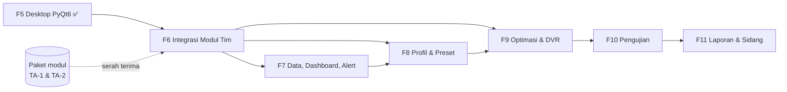
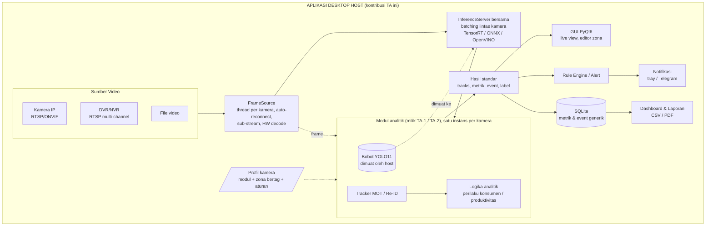

# Roadmap Development — Aplikasi Desktop Analitik Video Multi-Kamera (Host Model & Modul Analitik Tim)

> Dokumen induk dari seluruh fase development.
> Referensi utama: [`PROPOSAL-POC-Analitik-CCTV.md`](../../PROPOSAL-POC-Analitik-CCTV.md) (selanjutnya disebut **Proposal**, bagian dirujuk dengan tanda **§**).
> Dibuat: 2026-09-19 · **Revisi besar: 2026-11-09 (pasca sidang pra-progres)**, lihat §0.

---

## 0. Catatan Revisi 2026-11-09

Proposal dan Fase 0–5 disusun seolah aplikasi ini mengerjakan **seluruh rantai sendiri**: deteksi (YOLOv11 COCO), tracking (ByteTrack), dan analitik (dwell, heatmap, line-crossing). Setelah sidang pra-progres, ruang lingkup diperjelas. Topik ini dikerjakan **tiga orang**, dan aplikasi ini **tidak** membuat model deteksi maupun analitik sendiri:

| Bagian | Pemilik | Judul TA |
|---|---|---|
| **Aplikasi desktop host** (dokumen ini) | Nadhif | Aplikasi desktop analitik: UI multi-kamera, manajemen zona, laporan, alert; integrasi RTSP kamera & DVR; optimasi sumber daya PC edge |
| **Modul TA-1**: model YOLO11, MOT, dan analitik perilaku konsumen | Rekan TA-1 | *Evaluasi Algoritma Multi-Object Tracking dan Platform Analitik Video untuk Pengukuran Perilaku Konsumen pada Area Komersial* |
| **Modul TA-2**: model YOLO11, MOT + Re-ID, dan analitik produktivitas pegawai | Rekan TA-2 | *Pemantauan Aktivitas dan Produktivitas Pegawai pada Area Kerja Menggunakan Multi-Object Tracking dengan Re-Identifikasi pada Video CCTV* |

Konsekuensinya bagi rencana:

1. **Aplikasi menjadi host.** Aplikasi memuat **paket modul** dari rekan (bobot YOLO11, tracker, dan logika analitik), menjalankannya pada banyak kamera, lalu menampilkan, menyimpan, dan memberi alert dari hasilnya. Kontraknya ditetapkan di **Fase 6 (baru)**.
2. **Kode deteksi, tracking, dan analitik dari Fase 2–3 diturunkan statusnya** menjadi **modul baseline** (pengganti sementara dan alat uji), bukan kontribusi TA. Lihat catatan di [FASE-02](FASE-02-deteksi-sederhana-video-youtube.md) dan [FASE-03](FASE-03-tracking-analitik-inti.md).
3. **Penyimpanan, dashboard, alert, dan laporan dibuat generik** (Fase 7). Aplikasi tidak tahu arti "dwell" atau "produktivitas". Aplikasi hanya mengolah **metrik dan event** yang dideklarasikan modul.
4. **Optimasi sumber daya menjadi kontribusi inti** (Fase 9). Metrik utamanya adalah **jumlah kamera maksimum per PC edge**, bukan mAP atau MOTA.
5. **Evaluasi akurasi model (mAP, MOTA/IDF1, error dwell) dikeluarkan** dari Fase 10, karena itu ranah TA-1 dan TA-2. Aplikasi ini cukup membuktikan bahwa hasil modul **di dalam aplikasi identik** dengan hasil modul saat dijalankan mandiri (*uji paritas*).
6. Fase 6–10 lama dinomori ulang menjadi Fase 7–11.

---

## 1. Arah Proyek

| Aspek | Isi |
|---|---|
| **Fokus TA** | **Aplikasi desktop host** untuk analitik video pada PC edge: (a) UI multi-kamera, manajemen zona, alert, laporan; (b) integrasi **RTSP** ke kamera IP dan **DVR/NVR**; (c) **optimasi sumber daya** agar satu PC melayani sebanyak mungkin kamera. |
| **Yang tidak dikerjakan** | Melatih atau mengevaluasi model deteksi, membandingkan algoritma MOT/Re-ID, dan merancang metrik perilaku konsumen atau produktivitas. Semua itu dikerjakan TA-1 dan TA-2. |
| **Inti teknis** | `FrameSource` (RTSP/DVR/file) → **InferenceServer bersama** (YOLO11 milik modul; batching; TensorRT/ONNX/OpenVINO) → **modul analitik tim** (tracker + analitik, per kamera) → hasil standar (metrik, event, label) → GUI, SQLite, alert, laporan. |
| **Posisi terhadap Proposal** | Proposal (§6) adalah rancangan bersama. Aplikasi ini mengambil peran **"Agen edge: Python + PyQt6 desktop"** (Proposal §7) ditambah kontrak integrasi. Sinkronisasi cloud tetap opsional (Fase 8). |

### Usulan rumusan masalah (sesuaikan dengan proposal resmi pasca sidang)

| RM | Rumusan |
|---|---|
| **RM-1** | Bagaimana merancang aplikasi desktop yang dapat **memuat dan menjalankan model YOLO11 serta modul analitik MOT dari penelitian lain tanpa mengubah kode aplikasi**, lengkap dengan UI multi-kamera, manajemen zona, alert, dan laporan? |
| **RM-2** | Bagaimana mengintegrasikan aliran **RTSP dari kamera IP dan DVR/NVR** secara andal (koneksi ulang otomatis, latensi rendah, multi-channel)? |
| **RM-3** | Teknik optimasi apa yang paling efektif menekan pemakaian CPU/GPU/RAM, dan **berapa kamera maksimum** yang dapat dilayani satu PC edge pada berbagai kelas perangkat? |

### Usulan judul yang selaras

> **"Rancang Bangun Aplikasi Desktop Analitik Video Multi-Kamera Berbasis Modul dengan Integrasi Protokol RTSP dan Optimasi Sumber Daya pada Perangkat Edge"**

Usulan ini menghindari frasa "Multi-Object Tracking" dan "Platform Analitik" di judul, karena keduanya sudah dipakai TA-1/TA-2. Jika judul resmi sudah ditetapkan, gunakan judul resmi.

---

## 2. Daftar Fase

| Fase | Dokumen | Tujuan singkat | Status | Milestone | Estimasi |
|---|---|---|---|---|---|
| 0 | [FASE-00 — Persiapan Lingkungan](FASE-00-persiapan-lingkungan.md) | Environment Python/GPU, struktur repo, video uji | ✅ Selesai | — | — |
| 1 | [FASE-01 — Marker Area (Zona & Garis)](FASE-01-marker-area-zona.md) | Poligon zona & garis ternormalisasi → JSON | ✅ Selesai | M1 | — |
| 2 | [FASE-02 — Deteksi Sederhana](FASE-02-deteksi-sederhana-video-youtube.md) | YOLO11 COCO + hitung orang per zona | ✅ Selesai, **kini jadi baseline** | M1 | — |
| 3 | [FASE-03 — Tracking & Analitik Inti](FASE-03-tracking-analitik-inti.md) | ByteTrack, dwell, line-crossing, heatmap | ✅ Selesai, **kini jadi modul baseline** | M2 | — |
| 4 | [FASE-04 — Integrasi RTSP & IP Camera](FASE-04-integrasi-rtsp-ip-camera.md) | Ingest RTSP tahan-putus, ONVIF, template merek | ⚠️ Sebagian (kamera fisik belum diuji) | M3 | — |
| 5 | [FASE-05 — Aplikasi Desktop (PyQt6)](FASE-05-aplikasi-desktop-pyqt6.md) | GUI: manajemen kamera, live view, editor zona | ⚠️ Sebagian (kamera fisik & SUS belum) | M4a | — |
| **6** | [**FASE-06 — Integrasi Model & Modul Analitik Tim**](FASE-06-integrasi-model-modul-tim.md) | **Kontrak modul**, loader, YOLO11 dari paket modul, refaktor pipeline, alat uji kepatuhan | ⚠️ Sisi host selesai; menunggu modul TA-1/TA-2 | **M4b** | 2–3 minggu |
| 7 | [FASE-07 — Penyimpanan, Dashboard, Alert & Laporan](FASE-07-penyimpanan-dashboard-alert-laporan.md) | SQLite **generik** (metrik/event dari modul), dashboard dari manifest, rule engine, CSV/PDF | ⚠️ Sebagian (uji beban & crash-safety belum) | M4c | 3 minggu |
| 8 | [FASE-08 — Profil Kamera, Preset Modul & Import/Export](FASE-08-profil-konfigurasi-preset.md) | Profil v2 (kamera + modul + zona bertag + aturan), wizard preset, `.aioprofile` | Belum | **M4** | 1–2 minggu |
| 9 | [FASE-09 — Optimasi Sumber Daya Multi-Kamera, DVR & Packaging](FASE-09-optimasi-sumber-daya-packaging.md) | **InferenceServer + batching**, TensorRT/OpenVINO, sub-stream & HW decode, DVR multi-channel, uji kapasitas, installer | Belum | **M5** | 4 minggu |
| 10 | [FASE-10 — Pengujian & Evaluasi](FASE-10-pengujian-evaluasi.md) | Kapasitas kamera/PC, ablation optimasi, keandalan RTSP/DVR, paritas modul, black-box, SUS | Belum | M5 | 3 minggu |
| 11 | [FASE-11 — Dokumentasi & Laporan TA](FASE-11-dokumentasi-laporan-ta.md) | Buku TA, manual, panduan pembuat modul, demo, sidang | Paralel | **M6** | paralel + 3 minggu |

**Sisa estimasi (Fase 6–11):** ± 16–18 minggu. Fase 6 adalah **jalur kritis**, karena modul TA-1/TA-2 hanya bisa masuk setelah kontraknya disepakati.

### Milestone

| Milestone | Isi yang bisa didemokan | Selesai setelah |
|---|---|---|
| M1–M3 | MVP deteksi, analitik baseline, live RTSP | ✅ Fase 2–4 |
| **M4a** | GUI multi-kamera + editor zona (dengan modul baseline) | ✅ Fase 5 (sebagian) |
| **M4b — Host modul** | Aplikasi memuat **modul TA-1 dan TA-2** (atau versi awalnya), dan keduanya bisa dipilih per kamera tanpa ubah kode | Fase 6 |
| **M4 — Aplikasi lengkap** | + dashboard, alert, laporan, profil/preset | Fase 8 |
| **M5 — Terukur & siap rilis** | Kapasitas kamera/PC terukur sebelum dan sesudah optimasi, DVR multi-channel, installer | Fase 10 |
| **M6 — Sidang** | Buku TA, demo, slide | Fase 11 |

---

## 3. Alur Ketergantungan Fase



> Bagian **InferenceServer** di Fase 9 boleh dimulai paralel dengan Fase 7, karena hanya bergantung pada kontrak Fase 6.
> Bila modul rekan terlambat, Fase 7–9 tetap berjalan dengan **modul baseline**. Kontrak yang sama menjamin modul asli tinggal dipasang.

---

## 4. Arsitektur Target Akhir



Pembagian kerjanya: **host menjalankan model** (agar bisa dibagi dan di-batch lintas kamera, yang merupakan inti optimasi), sedangkan **modul menentukan isi model, tracker, dan analitiknya**.

Prinsip privasi Proposal §6/§11 tetap berlaku: video tidak keluar dari PC lokasi, dan yang disimpan hanya metrik/event.

---

## 5. Struktur Repository Target

```
Aplikasi_AIO_CCTV/
├── aio_cctv/
│   ├── core/                  # paths, secrets, logging, profil
│   ├── sources/               # FileSource, RTSPSource, ONVIF, template merek, DVR multi-channel (F9)
│   ├── zones/                 # model zona/garis (Fase 1)
│   ├── modules/               # (F6) api.py = kontrak modul, registry.py, host.py
│   ├── inference/             # Detector YOLO11 (F6), InferenceServer, backend export (F9)
│   ├── storage/               # (F7) SQLite generik, writer thread, agregator
│   ├── alerts/                # (F7) rule engine generik
│   ├── reports/               # (F7) ekspor CSV/PDF
│   ├── gui/                   # aplikasi PyQt6
│   └── pipeline.py            # (F6) perakit Source → Inference → Modul
├── modules/                   # paket modul terpasang (pengembangan)
│   ├── baseline/              # (F6) eks kode Fase 2–3: ByteTrack + dwell/line/heatmap
│   ├── ta1-perilaku-konsumen/ # diserahkan TA-1
│   └── ta2-produktivitas/     # diserahkan TA-2
├── configs/                   # profil kamera, template merek kamera
├── models/                    # (gitignore) bobot COCO untuk baseline
├── scripts/                   # check_module.py, benchmark_capacity.py, sim_cameras.sh
├── tests/
└── main.py
```

`aio_cctv/tracking/` dan `aio_cctv/analytics/` dari Fase 3 **dipindahkan** ke `modules/baseline/` di Fase 6.

---

## 6. Keterlacakan Rumusan Masalah → Fase

| RM / aspek | Fase |
|---|---|
| RM-1 host modul, UI multi-kamera, zona | F1, F5, **F6**, F8 |
| RM-1 alert & laporan | F7 |
| RM-2 RTSP kamera IP | F4, F10 |
| RM-2 DVR/NVR multi-channel | **F9**, F10 |
| RM-3 optimasi & kapasitas | **F9**, F10 |
| Privasi (Proposal §11) | F7, F11 |
| Usability | F5, F10 |

---

## 7. Konvensi yang Berlaku di Semua Fase

1. **Bahasa kode:** Python 3.11, nama modul/kelas bahasa Inggris, komentar & teks UI bahasa Indonesia.
2. **Koordinat zona ternormalisasi (0..1)**. Format ini juga yang diterima modul tim (kontrak Fase 6).
3. **Waktu berbasis timestamp** (`time.monotonic()` dari source), bukan hitungan frame. Modul menerima `ts` yang sama.
4. **Kontrak modul berversi** (`api_version`, SemVer). Perubahan yang merusak kompatibilitas wajib menaikkan versi mayor dan diberitahukan ke TA-1/TA-2.
5. **Setiap fase diakhiri:** tag git (`v0.<fase>`), logbook di `docs/logbook/`, dan checklist *Definition of Done*.
6. **Privasi by default:** tanpa pengenalan wajah, tanpa rekaman video mentah secara default, kredensial di OS keyring. Modul dilarang mengirim citra/biometrik di dalam event.
7. **Atribusi:** setiap model atau modul dari TA-1/TA-2 disebut sumbernya di aplikasi (menu Tentang/Modul) dan di buku TA.

---

## 8. Risiko Proyek Utama

| Risiko | Dampak | Mitigasi | Fase |
|---|---|---|---|
| Modul TA-1/TA-2 terlambat atau berubah-ubah | Integrasi molor | Kontrak disepakati dan dibekukan di awal F6; modul baseline sebagai pengganti; serah terima bertahap (v0 dummy → v1) | F6 |
| Batas tanggung jawab dengan TA-1 kabur ("Platform Analitik Video" ada di judul TA-1) | Dianggap tumpang tindih saat sidang | Tabel pembagian §0 disepakati bersama dan dikonfirmasi ke pembimbing; aplikasi ini = *runtime/host*, TA-1 = logika & metrik analitik | F6, F11 |
| Modul rekan lambat (mis. Re-ID mahal per orang) | Kapasitas kamera rendah | `module_ms` diukur terpisah dari `detect_ms`; kapasitas dilaporkan per modul; temuan diumpankan balik ke rekan | F9, F10 |
| Dependensi modul bentrok (versi ultralytics/boxmot/torch) | Modul gagal dimuat | `requirements` di manifest, versi dipin bersama; `check_module.py` | F6, F9 |
| Kamera/DVR fisik belum tersedia | RM-2 lemah | Pinjam ≥1 DVR + ≥2 kamera; MediaMTX untuk simulasi N kamera | F9, F10 |
| GIL Python membatasi banyak kamera dalam satu proses | Kapasitas mentok di CPU | Diukur; opsi worker multi-proses (F9 §5.6) | F9 |
| Ukuran installer besar (PyTorch) | Distribusi sulit | Varian ONNX/OpenVINO tanpa PyTorch | F9 |
