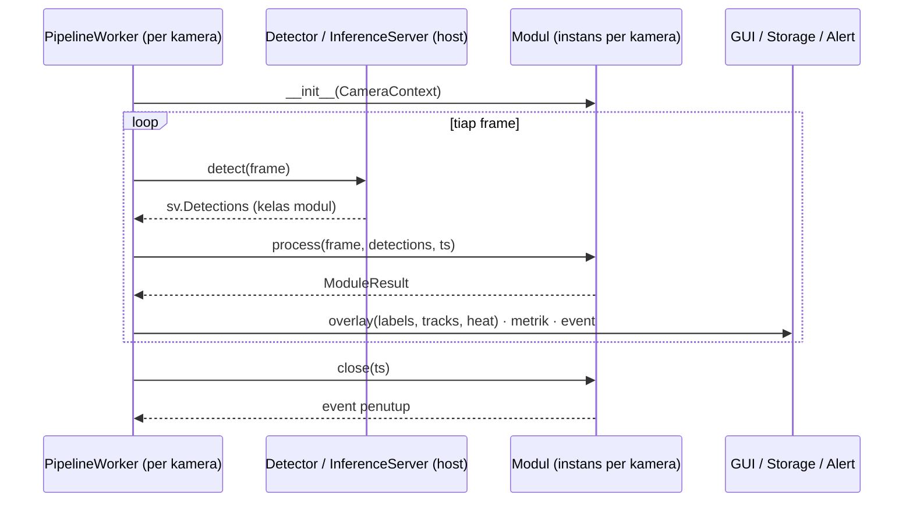

# FASE 6 — Integrasi Model & Modul Analitik Tim (Kontrak Host–Modul)

> Sebelumnya: [FASE-05](FASE-05-aplikasi-desktop-pyqt6.md) · Kembali ke [Roadmap](00-ROADMAP.md) · Berikutnya: [FASE-07 Data, Dashboard & Alert](FASE-07-penyimpanan-dashboard-alert-laporan.md)
> Latar belakang: [Roadmap §0](00-ROADMAP.md#0-catatan-revisi-2026-11-09). Aplikasi ini adalah **host**. Model YOLO11, tracker, dan analitik berasal dari TA-1 (perilaku konsumen) dan TA-2 (produktivitas pegawai, MOT + Re-ID).
> Estimasi: **2–3 minggu** · Milestone: **M4b — Host modul** · Menjawab: **RM-1**

---

## 1. Tujuan

1. Menetapkan **kontrak host–modul v1**: bentuk paket modul, manifest `module.yaml`, dan antarmuka Python yang diimplementasikan TA-1/TA-2.
2. Membuat aplikasi **memuat model YOLO11 dari paket modul**, termasuk kelas kustom yang dibaca dari `model.names`, bukan lagi `COCO_NAME_TO_ID`.
3. Merombak `Pipeline` agar urutannya **Source → Detector (host) → Modul (tracker + analitik)** dan menghasilkan **hasil standar** yang dipahami GUI, storage, dan alert tanpa tahu arti domainnya.
4. Memindahkan kode Fase 2–3 menjadi **modul baseline**, yang berfungsi sebagai implementasi acuan, contoh bagi rekan, dan pengganti sementara.
5. Menyediakan **alat uji kepatuhan** (`check_module.py`) yang dipakai rekan sebelum serah terima, serta **uji paritas** (hasil di aplikasi = hasil modul saat dijalankan mandiri).

## 2. Kondisi Awal (hasil audit kode 2026-11-09)

| Lokasi | Masalah terhadap ruang lingkup baru |
|---|---|
| `inference/detector.py` | `COCO_NAME_TO_ID = {"person": 0}`: model dengan kelas kustom tidak bisa dipakai |
| `pipeline.py` | `ByteTrackTracker` dan `AnalyticsEngine` di-*hardcode*: tracker/analitik rekan tidak bisa dipasang |
| `tracking/tracker.py` | `update(det)` tidak menerima frame, padahal tracker Re-ID (TA-2) butuh crop gambar |
| `gui/pages/settings.py` | Pilihan model tetap `yolo11n/s/m`, tanpa cara memasang model dari luar |
| `gui/workers/pipeline_worker.py` | Statistik memakai field khas baseline (`persons`, `line_totals`) |
| `scripts/compare_models.py`, `compare_trackers.py` | Membandingkan akurasi model/tracker, yang merupakan ranah TA-1. Diubah menjadi benchmark sumber daya di Fase 9 |

## 3. Pembagian Tanggung Jawab

| Komponen | Host (TA ini) | Modul (TA-1 / TA-2) |
|---|---|---|
| Ambil frame RTSP/DVR/file, reconnect | ✅ | |
| Memuat & menjalankan bobot YOLO11 (batching, TensorRT, dsb.) | ✅ | menyediakan file bobot + parameter |
| Tracker (ByteTrack/BoT-SORT/OC-SORT/Re-ID) | | ✅ |
| Logika analitik & definisi metrik/event | | ✅ |
| Menggambar zona/garis, menyimpan profil | ✅ | mendeklarasikan **peran zona** yang dibutuhkan |
| Overlay video, dashboard, alert, laporan, penyimpanan | ✅ (generik) | mendeklarasikan label/satuan/widget di manifest |
| Akurasi model & tracker (mAP, MOTA, IDF1) | | ✅ |
| Kinerja end-to-end & kapasitas kamera | ✅ | ikut menyumbang `module_ms` |

**Mengapa deteksi dijalankan host, bukan modul?** Bila setiap modul menjalankan YOLO-nya sendiri, model terduplikasi per kamera dan tidak bisa di-batch lintas kamera. Padahal itu teknik optimasi utama Fase 9. Dengan deteksi di host, satu salinan model melayani semua kamera yang memakai modul yang sama.

## 4. Kontrak v1

### 4.1 Struktur paket modul

```
ta2-produktivitas/
├── module.yaml            # manifest (wajib)
├── weights/
│   ├── yolo11s-pegawai.pt # bobot YOLO11 (Ultralytics), dimuat oleh HOST
│   └── osnet_x0_25.pt     # bobot Re-ID, dimuat oleh MODUL sendiri
├── analyzer.py            # entrypoint: kelas yang mengimplementasikan AnalyticsModule
├── presets/               # (Fase 8) preset zona/aturan/dashboard
│   └── kantor.json
├── samples/
│   └── demo.mp4           # klip pendek untuk check_module & uji paritas
└── README.md
```

Lokasi pencarian modul: `modules/` di repo (pengembangan), lalu `APP_DIR/modules/` (instalasi pengguna, dipasang lewat menu **Modul → Pasang dari folder/ZIP**).

### 4.2 Manifest `module.yaml`

```yaml
id: ta2-produktivitas              # unik, huruf kecil-strip
name: Pemantauan Produktivitas Pegawai
version: 0.1.0                     # versi modul (SemVer)
api_version: "1.0"                 # versi kontrak yang diikuti
authors: ["Tim TA-2"]
license: "AGPL-3.0"
entrypoint: analyzer:ProductivityModule   # <file>:<kelas>

model:                             # dimuat host melalui Ultralytics YOLO(...)
  weights: weights/yolo11s-pegawai.pt
  task: detect                     # detect | pose (keypoints diteruskan via det.data)
  imgsz: 640
  conf: 0.35
  iou: 0.5
  classes: [pegawai]               # subset dari model.names; kosong = semua kelas

requirements:                      # dicek saat modul dimuat; dipasang saat packaging (F9)
  - boxmot==11.0.2
  - ultralytics>=8.3

regions:                           # peran zona yang dipahami modul (dipakai wizard Fase 8)
  - {role: meja_kerja,   kind: zone, label: "Meja kerja",     hint: "Gambar area meja tiap pegawai", multiple: true}
  - {role: area_istirahat, kind: zone, label: "Area istirahat", optional: true}

params:                            # parameter yang bisa diatur pengguna (divalidasi host)
  idle_threshold_s: {type: float, default: 300, min: 10, label: "Batas idle (detik)"}
  min_fps:          {type: float, default: 8, label: "FPS minimum tracker"}

metrics:                           # nilai numerik per frame atau per interval
  - {key: people_count, label: "Jumlah pegawai",   unit: "orang", per_region: true, agg: avg}
  - {key: active_ratio, label: "Rasio aktif",      unit: "%",     per_region: true, agg: avg}

events:                            # kejadian diskrit
  - {type: idle_long,  label: "Pegawai idle terlalu lama", fields: {duration_s: float}}
  - {type: left_desk,  label: "Meninggalkan meja kerja",  fields: {duration_s: float}}

dashboard:                         # widget default (Fase 7)
  - {type: kpi,        metric: people_count}
  - {type: timeseries, metric: active_ratio, title: "Rasio aktif per zona"}
  - {type: events,     event: idle_long}
```

Host memvalidasi manifest dengan Pydantic. Jika ada field wajib yang hilang, `api_version` mayornya berbeda, file bobot tidak ada, atau requirement tidak terpenuhi, modul ditandai **tidak valid** dengan pesan yang jelas.

### 4.3 Antarmuka Python — `aio_cctv/modules/api.py`

File ini **diberikan apa adanya** ke TA-1/TA-2 (cukup disalin, karena hanya bergantung pada `numpy` dan `supervision`).

```python
"""Kontrak modul analitik AIO-CCTV v1.

Host memanggil satu instans modul per kamera:
    m = Kelas(ctx)                       # sekali, saat kamera mulai
    r = m.process(frame, detections, ts) # tiap frame yang diproses
    m.close(ts)                          # sekali, saat kamera berhenti
"""
from __future__ import annotations

from dataclasses import dataclass, field

import numpy as np
import supervision as sv

API_VERSION = "1.0"


@dataclass(frozen=True)
class Region:
    id: str
    name: str
    kind: str                               # "zone" | "line"
    points: list[tuple[float, float]]       # ternormalisasi 0..1 (konvensi Fase 1)
    role: str | None = None                 # peran dari manifest, mis. "meja_kerja"


@dataclass(frozen=True)
class CameraContext:
    camera_id: str
    frame_wh: tuple[int, int]               # resolusi frame yang akan diterima
    fps: float                              # FPS EFEKTIF yang diproses (sesudah stride Fase 9)
    regions: list[Region]
    params: dict                            # sudah divalidasi terhadap manifest
    module_dir: str                         # path paket, untuk memuat bobot Re-ID dsb.


@dataclass
class Metric:
    key: str                                # harus terdaftar di manifest.metrics
    value: float
    region_id: str | None = None


@dataclass
class Event:
    type: str                               # harus terdaftar di manifest.events
    ts: float
    region_id: str | None = None
    track_id: int | None = None
    data: dict = field(default_factory=dict)   # JSON sederhana; DILARANG berisi citra


@dataclass
class ModuleResult:
    tracks: sv.Detections                   # deteksi + tracker_id
    metrics: list[Metric] = field(default_factory=list)
    events: list[Event] = field(default_factory=list)
    labels: dict[int, str] = field(default_factory=dict)  # track_id -> teks overlay
    heat: np.ndarray | None = None          # opsional: grid akumulasi ≥ 0; host yang menormalisasi


class AnalyticsModule:
    """Kelas dasar. Modul cukup meng-override process() dan bila perlu close()."""

    def __init__(self, ctx: CameraContext) -> None:
        self.ctx = ctx

    def process(self, frame: np.ndarray, detections: sv.Detections, ts: float) -> ModuleResult:
        """frame: BGR uint8 read-only. detections: hasil YOLO11 host, sudah difilter kelas & conf.
        ts: detik monotonic dari source. Harus cepat; jangan blocking I/O."""
        raise NotImplementedError

    def close(self, ts: float) -> list[Event]:
        """Tutup sesi yang masih terbuka (mis. dwell/idle berjalan) saat kamera berhenti."""
        return []
```

Aturan tambahan yang ditulis di README kontrak:

- `frame` diberikan **read-only** (`flags.writeable = False`). Modul tidak boleh menggambar di atasnya, karena overlay digambar host dari `labels`.
- Modul **tidak boleh** membuat thread, mengakses jaringan, atau menulis file. File yang perlu dibaca diambil dari `ctx.module_dir`.
- Pengecualian dari `process()` ditangkap host. Kamera itu ditandai "modul error" dan kamera lain tetap berjalan.
- Parameter tracker yang bergantung FPS dihitung dari `ctx.fps`, **bukan** dari FPS kamera, karena host bisa menerapkan *frame stride* (Fase 9).

### 4.4 Alur pemanggilan



## 5. Implementasi di Aplikasi

### 5.1 Struktur file

```
aio_cctv/modules/
├── api.py          # kontrak (§4.3); + helper CameraContext.zones()/lines()/to_pixels()
├── manifest.py     # Pydantic: ModuleManifest, ModelSpec, RegionSpec, ParamSpec, MetricSpec, EventSpec
├── registry.py     # discover/inspect/install (folder & ZIP), import paket modul, load_entrypoint
├── host.py         # ModuleRunner (timing, frame read-only, ModuleError), build_context,
│                   # validate_result, result_to_record (format JSONL paritas)
└── check.py        # run_checks(): dipakai scripts/check_module.py & tombol "Uji modul"
aio_cctv/annotate.py            # overlay generik + render_heat (eks analytics/annotate.py)
aio_cctv/pipeline.py            # Detector → ModuleRunner
modules/baseline/               # eks aio_cctv/tracking + aio_cctv/analytics (Fase 3)
scripts/check_module.py         # uji kepatuhan & paritas
scripts/run_module.py           # pengganti run_analytics.py: jalankan modul apa pun pada video
scripts/legacy/                 # compare_models.py, compare_trackers.py (ranah TA-1)
aio_cctv/gui/pages/modules.py   # halaman Modul
aio_cctv/gui/widgets/module_params.py   # formulir params dari manifest
docs/kontrak-modul.md           # panduan pembuat modul
```

### 5.2 Registry & pemuatan entrypoint

Folder modul didaftarkan sebagai **paket Python bernama unik** (`aio_mod_<id>`, `__path__` = folder modul), lalu entrypoint diimpor sebagai submodulnya (`aio_mod_<id>.analyzer`). Ada dua alasan memakai cara ini, bukan `spec_from_file_location` per file:

1. Modul boleh memakai **import relatif** (`from .dwell import ZoneDwell`), sehingga bisa terdiri dari banyak file.
2. Dua modul yang sama-sama punya `analyzer.py`/`tracker.py` tidak saling menimpa di `sys.modules`. Ini diuji di `tests/test_modules.py`.

```python
def import_package(m: ModuleManifest) -> str:
    name = "aio_mod_" + m.id.replace("-", "_")
    pkg = types.ModuleType(name)
    pkg.__path__ = [m.path]
    sys.modules[name] = pkg
    return name


def load_entrypoint(m: ModuleManifest) -> type[AnalyticsModule]:
    file, cls_name = m.entrypoint.split(":")
    mod = importlib.import_module(f"{import_package(m)}.{file}")
    return getattr(mod, cls_name)
```

Lokasi pencarian: `modules/` di repo (bawaan) lalu `APP_DIR/modules/` (dipasang lewat GUI). Jika id-nya sama, yang terakhir menang. `install()` menolak ZIP berisi path yang keluar dari folder tujuan (*zip slip*).

### 5.3 Detector membaca kelas dari model

```python
class Detector:
    def __init__(self, weights, classes=None, conf=0.35, iou=0.5, imgsz=640, device=None):
        self.model = YOLO(str(weights))
        self.names = dict(self.model.names)                      # {id: nama}, dari bobot rekan
        self.class_ids = self._resolve(classes)                  # None = semua kelas;
                                                                 # kelas tak dikenal -> ValueError
    @classmethod
    def from_manifest(cls, manifest, device=None): ...

    def detect_batch(self, frames): ...                          # disiapkan untuk Fase 9
```

Signature konstruktor sengaja tetap kompatibel dengan skrip Fase 2 (`detect_zones.py`).

Model `.onnx`, `.engine`, atau folder OpenVINO juga dimuat lewat `YOLO(path)`. Konversinya dikerjakan Fase 9.

### 5.4 Pipeline baru

```python
class Pipeline:
    def __init__(self, manifest, module_cls, ctx, device=None):
        self.detector = Detector(manifest.model, Path(manifest.path), device)  # Fase 9: InferenceServer
        self.module = module_cls(ctx)
        self.times = StageTimes()                       # detect_ms, module_ms, render_ms

    def step(self, image, ts) -> ModuleResult:
        t0 = time.perf_counter()
        det = self.detector(image)
        t1 = time.perf_counter()
        image.flags.writeable = False
        res = self.module.process(image, det, ts)
        t2 = time.perf_counter()
        self.times.detect_ms, self.times.module_ms = (t1 - t0) * 1e3, (t2 - t1) * 1e3
        return res
```

`Annotator` digeneralisasi: menggambar zona/garis dari profil, kotak dan `track_id` dari `res.tracks`, teks dari `res.labels`, dan heatmap dari `res.heat`. Annotator tidak lagi membaca struktur khas baseline (`dwell_now`, `line_totals`).

### 5.5 Modul baseline

`aio_cctv/tracking/` dan `aio_cctv/analytics/` dipindah ke `modules/baseline/` dan dibungkus `BaselineModule(AnalyticsModule)`:

| Isi | Peran |
|---|---|
| ByteTrack + dwell + line-crossing + heatmap (kode Fase 3, sudah teruji) | Implementasi acuan kontrak; contoh untuk rekan |
| `model.weights: ../../models/yolo11n.pt`, `classes: [person]` | Dipakai sebelum bobot rekan tersedia |
| `tests/test_dwell.py`, `test_lines.py` ikut pindah | Bukti kontrak tidak merusak perilaku lama |

Di laporan TA, modul baseline disebut sebagai **alat uji**, bukan kontribusi analitik.

### 5.6 GUI

| Bagian | Perubahan |
|---|---|
| **Halaman Modul** (baru) | Tabel modul terpasang: nama, versi, penulis, model (kelas, imgsz), status validasi, tombol *Pasang dari folder/ZIP*, *Uji modul* (menjalankan `check_module` pada `samples/`) |
| Dialog kamera / profil | Pilih modul per kamera + isian `params` yang dibangkitkan otomatis dari manifest. Disimpan di `CameraConfig.module_id` & `module_params` (kamera lama otomatis `baseline`); pindah ke `ProfileV2` di Fase 8 |
| Editor zona | Kombo **Tipe** (dwell/occupancy/presence, semantik baseline) diganti **Peran** dari `manifest.regions`; tersimpan sebagai `Zone.role`/`Line.role` (field opsional, profil lama tetap terbaca). Pratinjau deteksi memakai model modul kamera |
| Pengaturan | Hapus pilihan `yolo11n/s/m`; ukuran model kini ditentukan modul |
| `VideoTile` / status | Tampilkan metrik generik (label + satuan dari manifest), `detect_ms`, `module_ms`, status "modul error" |

## 6. Alat Uji Kepatuhan — `scripts/check_module.py`

Dijalankan rekan **sebelum serah terima**, dan oleh host saat modul dipasang:

```
$ python scripts/check_module.py modules/ta2-produktivitas --frames 300
[OK] manifest valid (api 1.0, modul 0.1.0)
[OK] requirements terpenuhi
[OK] bobot dimuat: kelas = {0: 'pegawai'}, imgsz 640
[OK] entrypoint ProductivityModule dapat diinstansiasi
[OK] 300 frame samples/demo.mp4: tidak ada exception
[OK] semua Metric.key & Event.type terdaftar di manifest
[OK] Event.data dapat di-serialisasi JSON, tidak ada ndarray
[INFO] detect_ms p50 9.8 / p95 12.1 · module_ms p50 4.2 / p95 15.7
```

### Uji paritas

Rekan menyertakan keluaran acuan dari skrip mandirinya (`samples/expected.jsonl`: metrik & event per frame). Host menjalankan modul yang sama pada video yang sama dengan **stride 1 dan backend yang sama**, lalu membandingkannya. Targetnya, jumlah event per tipe dan nilai metrik identik (toleransi float 1e-6). Perbedaan berarti ada kesalahan integrasi (urutan warna BGR/RGB, skala koordinat, `ts`, filter kelas), dan ini menjadi bukti utama RM-1 di Fase 10.

## 7. Kesepakatan dengan TA-1 & TA-2 (lakukan di minggu pertama)

- [ ] Kontrak v1 (§4) disetujui; file `api.py` dan contoh `modules/baseline/` dibagikan.
- [ ] Versi Ultralytics/torch/boxmot dipin bersama.
- [ ] Daftar kelas model tiap modul dan `imgsz` yang dipakai saat training.
- [ ] Tracker dan Re-ID yang dipakai, termasuk kebutuhan FPS minimumnya (penting untuk stride Fase 9).
- [ ] Daftar metrik & event yang akan ditampilkan, beserta label Indonesianya.
- [ ] Peran zona yang dibutuhkan (mis. TA-1: `rak`, `kasir`, `pintu`; TA-2: `meja_kerja`).
- [ ] Jadwal serah terima: **v0** (dummy: bobot apa saja + analitik sederhana, untuk menguji pipa) → **v1** (hasil penelitian).
- [ ] Lisensi & atribusi bobot dan kode modul.
- [ ] Batas tanggung jawab (§3) dikonfirmasi ke pembimbing masing-masing.

## 8. Pengujian Fase 6

- [ ] `check_module.py` lulus untuk baseline, modul v0 TA-1, dan modul v0 TA-2.
- [ ] Dua kamera berjalan bersamaan dengan **modul berbeda** (TA-1 di kamera A, TA-2 di kamera B).
- [ ] Ganti modul pada kamera tanpa mengubah kode aplikasi (`git diff` kosong).
- [ ] Modul yang sengaja melempar exception hanya mematikan kamera itu; kamera lain tetap berjalan.
- [ ] Unit test baseline (`test_dwell`, `test_lines`) tetap lulus setelah dipindah.
- [ ] Uji paritas baseline: hasil sebelum refaktor = sesudah refaktor.

## 9. Keluaran (Deliverables)

| Keluaran | Lokasi |
|---|---|
| Kontrak v1 + README pembuat modul | `aio_cctv/modules/api.py`, `docs/kontrak-modul.md` |
| Registry, host, pipeline baru, annotator generik | `aio_cctv/modules/`, `aio_cctv/pipeline.py` |
| Modul baseline | `modules/baseline/` |
| `check_module.py` + uji paritas | `scripts/`, `tests/` |
| Halaman Modul (GUI) | `aio_cctv/gui/pages/modules.py` |
| Diagram komponen host–modul (Bab III) | `docs/diagram/` |

## 10. Definition of Done

- [ ] Kontrak v1 dibekukan dan disetujui TA-1 & TA-2 (tercatat di logbook).
- [ ] Aplikasi menjalankan baseline + ≥1 modul rekan (v0 atau v1) dari paket, tanpa kode khusus modul di host.
- [ ] Tidak ada lagi `COCO_NAME_TO_ID`, `ByteTrackTracker`, atau `AnalyticsEngine` yang dirujuk langsung dari `aio_cctv/` (host).
- [ ] Tag `v0.6-module-host` → **Milestone M4b**.

## 11. Risiko & Mitigasi

| Risiko | Mitigasi |
|---|---|
| Rekan butuh deteksi bertahap (mis. deteksi orang lalu klasifikasi aktivitas per crop) | Diizinkan di dalam `process()`; biayanya tercatat di `module_ms`. Bila sering diminta, kontrak v1.1 dapat menambah "model kedua" yang dijalankan host |
| Modul butuh `task: pose` / segmentasi | `task` di manifest; host meneruskan keypoints/mask lewat `det.data` |
| Kontrak berubah di tengah jalan | `api_version` + host mendukung v1.x mundur; perubahan mayor hanya lewat kesepakatan tertulis |
| Kode modul tidak tepercaya | Modul berasal dari tim sendiri. Tetap tampilkan peringatan saat memasang modul dari ZIP, dan catat hash paketnya |
| Bobot rekan dilatih dengan imgsz/kelas berbeda dari asumsi | Semuanya dibaca dari bobot (`model.names`) dan manifest, tidak ada asumsi di host |

## 12. Status Implementasi (2026-11-09)

Rincian & bukti: [logbook 2026-11-09 — Fase 6](../logbook/2026-11-09-fase-06.md).

| Butir | Status |
|---|---|
| Kontrak v1 (`api.py`, `manifest.py`) + panduan [`docs/kontrak-modul.md`](../kontrak-modul.md) | ✅ draf siap dibagikan, **belum disepakati** TA-1/TA-2 |
| Registry (discover/inspect/install folder & ZIP), host, pipeline baru, annotator generik | ✅ |
| Modul baseline + uji paritas sebelum/sesudah refaktor (1452 frame identik) | ✅ |
| `check_module.py` (kepatuhan + `--record`/`--expected` paritas), `run_module.py` | ✅ |
| GUI: halaman Modul, modul & params per kamera, peran zona, statistik generik | ✅ (diuji headless) |
| Modul v0 dari TA-1 / TA-2 terpasang & lulus `check_module` | ⏳ menunggu serah terima |

Pengujian §8:

- [x] `check_module.py` lulus untuk baseline (`[ ]` modul v0 TA-1, `[ ]` modul v0 TA-2)
- [x] Dua kamera bersamaan dengan modul berbeda (diuji dengan baseline + modul uji)
- [x] Ganti modul pada kamera tanpa mengubah kode aplikasi (lewat dialog kamera)
- [x] Modul yang melempar exception hanya mematikan kamera itu
- [x] Unit test baseline (`test_dwell`, `test_lines`) tetap lulus setelah dipindah
- [x] Uji paritas baseline: sebelum refaktor = sesudah refaktor

Definition of Done §10: butir 3 (tidak ada rujukan langsung ke kode baseline dari host) ✅. Butir 1 (kontrak disepakati), butir 2 (≥ 1 modul rekan berjalan), dan butir 4 (tag `v0.6-module-host`) masih menunggu TA-1/TA-2.
