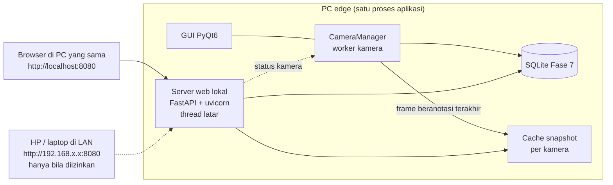

# FASE 8 — Profil Kamera, Preset Modul, Import/Export & Dashboard Web Lokal

> Sebelumnya: [FASE-07](FASE-07-penyimpanan-dashboard-alert-laporan.md) · Kembali ke [Roadmap](00-ROADMAP.md) · Berikutnya: [FASE-09 Optimasi & DVR](FASE-09-optimasi-sumber-daya-packaging.md)
> Referensi Proposal: **§4 RM-3 lama** (konfigurasi tanpa ubah kode), **§6** (perbedaan antar-bisnis ditentukan konfigurasi), **§8.4** (konfigurasi JSON)
> Estimasi: **2–3 minggu** (profil & preset 1–2 minggu + dashboard web ±1 minggu) · Milestone: **M4 — Aplikasi lengkap** · Menjawab: **RM-1** (manajemen zona, tanpa ubah kode)
> *Revisi 2026-11-09: dahulu FASE-07. "Template vertikal" (F&B/ritel/klinik) yang dibuat host **diganti** dengan **preset yang dikirim modul**, karena pengetahuan domain kini milik TA-1/TA-2. Sinkronisasi cloud diperkecil menjadi catatan opsional.*

---

## 1. Tujuan

1. **Skema profil v2**: satu profil per kamera = sumber + **modul terpilih** + parameter modul + zona/garis **bertag peran** + aturan alert + tata letak dashboard. Profil v1 (Fase 1) dimigrasi otomatis.
2. **Preset dari modul**: paket modul membawa `presets/*.json` (mis. TA-1: "Minimarket", "Kafe"; TA-2: "Kantor terbuka"). Wizard host memandu pengguna menggambar setiap slot.
3. **Import/export profil** (`.aioprofile`).
4. **Bukti RM-1**: memasang modul/preset baru dan mengganti modul pada kamera = **0 baris kode host berubah**.
5. **Dashboard web lokal (localhost)**: ringkasan kamera, analitik, alert, dan laporan dapat dibuka dari browser di PC yang sama, atau dari HP/PC lain di LAN bila diizinkan. Ini **tambahan** untuk aplikasi desktop, bukan pengganti (§8).

## 2. Konsep: Modul → Preset → Profil

| | **Modul** (Fase 6) | **Preset** (di dalam paket modul) | **Profil** (milik pengguna) |
|---|---|---|---|
| Pembuat | TA-1 / TA-2 | TA-1 / TA-2 | Pengguna, lewat wizard host |
| Isi | Model, tracker, analitik, deklarasi metrik/event/peran zona | Slot zona per peran + hint, aturan default, dashboard default, nilai parameter | Koordinat zona nyata di kamera tertentu + aturan yang disesuaikan |
| Contoh | `ta1-perilaku-konsumen` | "Minimarket: rak promo, antrean kasir, pintu" | "Toko Sumber Rejeki – Kamera Kasir" |

## 3. Skema Profil v2 — `aio_cctv/core/profile_v2.py`

```python
from typing import Literal

from pydantic import BaseModel, Field

from aio_cctv.zones.models import Line, SourceConfig, Zone


class ZoneV2(Zone):
    role: str | None = None                 # dari manifest.regions[].role


class LineV2(Line):
    role: str | None = None


class ModuleBinding(BaseModel):
    module_id: str
    module_version: str                     # versi saat profil dibuat; peringatan bila berbeda
    preset_id: str | None = None
    params: dict = Field(default_factory=dict)


class Rule(BaseModel):                      # tipe & field dari Fase 7 §3.5
    id: str
    type: Literal["metric_gt", "metric_lt", "event", "camera_offline", "module_error", "overload"]
    metric: str | None = None
    event: str | None = None
    region_role: str | None = None
    threshold: float | None = None
    for_s: float = 0
    window_s: float = 60
    min_count: int = 1
    cooldown_s: float = 300
    message: str = ""
    enabled: bool = True


class DashboardWidget(BaseModel):
    type: Literal["kpi", "timeseries", "hourly", "events", "heatmap", "health"]
    metric: str | None = None
    event: str | None = None
    title: str = ""


class PerfSettings(BaseModel):              # diisi Fase 9
    stream: Literal["main", "sub"] = "sub"
    target_fps: float = 10.0
    priority: Literal["normal", "low"] = "normal"


class ProfileV2(BaseModel):
    schema_version: Literal[2] = 2
    profile_id: str
    name: str = ""
    source: SourceConfig | None = None
    module: ModuleBinding
    zones: list[ZoneV2] = Field(default_factory=list)
    lines: list[LineV2] = Field(default_factory=list)
    rules: list[Rule] = Field(default_factory=list)
    dashboard: list[DashboardWidget] = Field(default_factory=list)
    perf: PerfSettings = Field(default_factory=PerfSettings)


def migrate(data: dict) -> ProfileV2:
    """v1 (Fase 1) -> v2: zona/garis tetap, modul diisi baseline."""
    if data.get("schema_version", 1) == 1:
        data = {**data, "schema_version": 2,
                "module": {"module_id": "baseline", "module_version": "1.0.0"}}
        data.pop("target_classes", None)    # kini ditentukan manifest modul
    return ProfileV2.model_validate(data)
```

`params` divalidasi terhadap `manifest.params` (tipe, min/max, default). Kalau modul diperbarui dan sebuah parameter hilang atau berubah tipe, profil tetap dimuat dengan nilai default, lalu pengguna diberi peringatan.

## 4. Format Preset — `modules/<id>/presets/<preset>.json`

```json
{
  "preset_id": "minimarket",
  "label": "Minimarket",
  "description": "Pengunjung per jam, antrean kasir, area rak yang paling sering didatangi",
  "slots": [
    { "key": "pintu", "kind": "line", "role": "pintu", "label": "Pintu masuk",
      "hint": "Tarik garis melintang pintu, arah panah = masuk" },
    { "key": "kasir", "kind": "zone", "role": "kasir", "label": "Antrean kasir",
      "hint": "Gambar lantai tempat orang mengantre" },
    { "key": "rak",   "kind": "zone", "role": "rak",   "label": "Rak promo",
      "multiple": true, "optional": true }
  ],
  "params": { "min_dwell_s": 5 },
  "rules": [
    { "id": "antrean", "type": "metric_gt", "metric": "people_count", "region_role": "kasir",
      "threshold": 4, "for_s": 30, "message": "Antrean kasir > 4 orang" }
  ],
  "dashboard": [
    { "type": "kpi", "metric": "visitors_in" },
    { "type": "hourly", "metric": "visitors_in", "title": "Pengunjung per jam" },
    { "type": "heatmap" }
  ]
}
```

Isi preset (peran, metrik, aturan) adalah keputusan TA-1/TA-2. Host hanya memvalidasi bahwa `role`, `metric`, dan `event` yang dirujuk memang ada di manifest modulnya.

## 5. Wizard (GUI)

```
Langkah 1  Pilih kamera ................ [Kasir (Hikvision DVR ch 3) ▼]
Langkah 2  Pilih modul ................. ( ) Perilaku Konsumen (TA-1)  ( ) Produktivitas (TA-2)  ( ) Baseline
Langkah 3  Pilih preset ................ ( ) Minimarket  ( ) Kafe  ( ) Kosong
Langkah 4  Gambar area per slot ........ "Gambar lantai tempat orang mengantre"   [Lewati — opsional]
Langkah 5  Parameter & aturan .......... dibangkitkan dari manifest; nilai default dari preset
Langkah 6  Kinerja ..................... Stream: sub ▼  Target FPS: 10   (Fase 9)
Langkah 7  Ringkasan & simpan
```

`QWizard` dengan halaman dinamis per slot. Editor zona Fase 5 dipakai ulang sebagai widget.

## 6. Import / Export — `.aioprofile`

ZIP berisi `profile.json`, `snapshot.jpg` (acuan visual), dan `meta.json` (versi aplikasi, `module_id@version`, resolusi). Kredensial dan URL kamera **tidak** disertakan. Saat import, bila modul belum terpasang atau versinya berbeda, aplikasi memberi tahu pengguna.

## 7. Protokol Uji "Tanpa Ubah Kode" (bukti RM-1)

1. Bekukan kode host: `git tag v0.8-freeze`.
2. Pasang modul TA-1 dan TA-2 **dari ZIP** lewat GUI.
3. Untuk setiap modul × ≥1 preset: penguji menjalankan wizard dari nol pada video/kamera yang sesuai. Catat waktu (menit), jumlah langkah, dan `git diff --stat v0.8-freeze` (harus kosong).
4. Ganti modul kamera A dari TA-1 ke TA-2 dan sebaliknya. Pastikan dashboard, alert, dan laporan menyesuaikan.
5. Pasang **versi baru** sebuah modul (mis. v0 → v1). Pastikan profil lama tetap termuat.

| Modul | Preset | Sumber video | Waktu konfigurasi | Langkah | Baris kode host diubah | Dashboard/alert sesuai? |
|---|---|---|---|---|---|---|
| TA-1 | Minimarket | … | … | … | **0** | ✓/✗ |
| TA-2 | Kantor | … | … | … | **0** | ✓/✗ |
| Baseline | — | … | … | … | **0** | ✓/✗ |

## 8. Dashboard Web Lokal (localhost)

> Latar: proyek open-source acuan dari dosen pembimbing diakses lewat browser di `localhost`. Fitur ini menyediakan pengalaman yang sama **tanpa** mengganti aplikasi desktop. Seluruh pemrosesan video tetap di aplikasi desktop; server web hanya **membaca** database yang sudah ada (Fase 7) dan status kamera.

### 8.1 Arsitektur



- Server berjalan sebagai **thread latar di dalam aplikasi desktop** (uvicorn di `threading.Thread`), dihentikan oleh `CameraManager.shutdown()`.
- Kueri memakai ulang `aio_cctv/storage/queries.py` (koneksi read-only). Tidak ada logika analitik baru di sisi web.
- Halaman web berupa HTML statis + JavaScript ringan (grafik dengan Chart.js yang **disertakan lokal** di `aio_cctv/web/static/`, tanpa CDN), sehingga tetap jalan tanpa internet.

### 8.2 Halaman & API

| Halaman | Isi | Endpoint |
|---|---|---|
| Ringkasan | Daftar kamera: status (streaming/reconnecting/berhenti), modul, FPS proses, `detect_ms`/`module_ms`, alert belum dibaca; snapshot tiap kamera | `GET /api/cameras`, `GET /api/cameras/{id}/snapshot.jpg` |
| Analitik | Widget dari `manifest.dashboard` (KPI, grafik waktu, per jam, event, heatmap) | `GET /api/cameras/{id}/dashboard?days=1` |
| Alert | Riwayat + tombol tandai dibaca | `GET /api/alerts`, `POST /api/alerts/ack` |
| Laporan | Unduh CSV/PDF per periode | `GET /api/reports/csv`, `GET /api/reports/pdf` |
| Kesehatan | Status server, versi aplikasi, modul terpasang | `GET /api/health` |

Web bersifat **read-only** kecuali *acknowledge* alert. Menambah kamera, menggambar zona, dan memasang modul tetap di aplikasi desktop.

### 8.3 Video: snapshot, bukan streaming

Streaming video live ke browser (MJPEG/HLS/WebRTC) mengharuskan setiap kamera di-encode ulang, dan ini bertentangan dengan tujuan efisiensi Fase 9. Karena itu:

| Halaman | Cara | Alasan |
|---|---|---|
| Ringkasan (grid semua kamera) | **Snapshot JPEG** frame beranotasi terakhir, di-refresh tiap 2 detik | Ringan walau kamera banyak |
| Detail satu kamera | **MJPEG ±10 fps** (maks. 15) dengan kotak & label; bisa dialihkan ke snapshot | Video bergerak hanya untuk kamera yang sedang ditonton |
| *(Opsional, belum dibuat)* video asli | Relay WebRTC MediaMTX/go2rtc tanpa encode ulang, tanpa overlay | Untuk tampilan mulus; dicatat sebagai pengembangan lanjut |

- Frame diambil dari `FrameHub` yang diisi worker pada laju tampilan GUI yang sudah ada (`display_fps`), sehingga **tidak ada anotasi tambahan**. Encode JPEG hanya terjadi bila ada frame baru *dan* ada penonton; saat halaman ditutup, beban tambahannya nol.
- Bila mode blur aktif (Fase 7), snapshot & MJPEG memakai frame yang sudah diburamkan.

### 8.4 Keamanan & privasi

| Aspek | Keputusan |
|---|---|
| Alamat bawaan | `127.0.0.1:8080`: hanya bisa dibuka dari PC itu sendiri |
| Akses LAN | Opsi "Izinkan akses dari jaringan lokal" di Pengaturan (bind `0.0.0.0`), **nonaktif secara default**, disertai peringatan |
| Login | Wajib bila akses LAN aktif: kata sandi diatur di Pengaturan, disimpan sebagai hash di OS keyring; sesi berupa cookie dengan masa berlaku |
| Internet | Tidak didukung; dokumentasi melarang port-forward. Akses jarak jauh = pengembangan lanjut (VPN) |
| Data | Hanya agregat, event, alert, dan snapshot; tanpa rekaman video |

### 8.5 Pengaturan (GUI desktop)

Grup baru **"Dashboard web"**: aktif/nonaktif (default aktif di localhost), port (default 8080), izinkan akses LAN, ubah kata sandi, dan tautan "Buka di browser" (`QDesktopServices.openUrl`).

### 8.6 Struktur file

```
aio_cctv/web/
├── server.py        # WebServer: FastAPI app + uvicorn di thread latar, start/stop
├── api.py           # endpoint JSON (memanggil storage/queries.py)
├── auth.py          # login, hash kata sandi, cookie sesi
└── static/          # index.html, app.js, style.css, chart.umd.min.js (lokal)
```

Dependensi tambahan (grup `web` di `pyproject.toml`): `fastapi`, `uvicorn`.

### 8.7 Pengujian

- Unit test endpoint dengan `fastapi.testclient` (DB sintetis seperti `tests/test_storage.py`).
- Angka di web = angka di dashboard desktop untuk kamera & rentang yang sama.
- Akses dari HP di LAN: tanpa login ditolak, dengan login berhasil; saat opsi LAN mati, tidak bisa diakses dari luar PC.
- Beban: CPU/RAM aplikasi dengan dan tanpa satu browser membuka halaman Ringkasan (dicatat untuk Fase 9).

## 9. (Opsional) Sinkronisasi Metrik ke Cloud

Hanya dikerjakan bila M5 tercapai lebih awal. Thread `CloudSync` mengirim baris `metric_minute` yang belum terkirim ke endpoint FastAPI minimal (`POST /v1/metrics`, API key per lokasi). Isinya hanya angka agregat, tanpa video. Toggle **nonaktif secara default**. Jika tidak sempat, cukup dijelaskan sebagai rancangan di Bab III/V.

## 10. Keluaran (Deliverables)

| Keluaran | Lokasi |
|---|---|
| Profil v2 + migrasi (dari profil v1 & `cameras.json` Fase 6–7) | `aio_cctv/zones/models.py` (`Profile`, `ModuleBinding`), `CameraManager._migrate_camera` |
| Format preset (bagian dari kontrak modul) | `docs/kontrak-modul.md` |
| Wizard, import/export | `aio_cctv/gui/` |
| Tabel uji "tanpa ubah kode" | `docs/logbook/` |
| Dashboard web lokal (server, API, halaman statis) | `aio_cctv/web/` |

## 11. Definition of Done

- [ ] Profil v1 lama termuat otomatis sebagai v2 dengan modul baseline.
- [ ] Wizard berjalan untuk preset dari ≥2 modul.
- [ ] Export → import di PC lain berfungsi.
- [ ] Uji §7 lulus dengan **0 baris kode host diubah**.
- [ ] Dashboard web terbuka di `http://localhost:8080` dengan angka yang sama dengan dashboard desktop; akses LAN memerlukan login.
- [ ] Tag `v0.8-profiles` → **Milestone M4**.

## 12. Risiko & Mitigasi

| Risiko | Mitigasi |
|---|---|
| Rekan belum membuat preset | Profil tetap bisa dibuat manual (preset "Kosong" + peran dari manifest) |
| Versi modul berubah dan merusak profil | `module_version` di profil + validasi params dengan nilai default + peringatan |
| Skema profil berubah lagi | `schema_version` + `migrate()` berantai + unit test profil lama |
| Port 8080 sudah dipakai program lain | Port dapat diubah di Pengaturan; pesan jelas bila gagal bind |
| Server web menambah beban PC | Snapshot on-demand (bukan streaming); beban diukur di Fase 9; server bisa dimatikan |
| Dashboard terbuka ke LAN tanpa sengaja | Default `127.0.0.1`; akses LAN harus diaktifkan eksplisit dan wajib login |

## 13. Status Implementasi (2026-11-09)

Rincian & bukti: [logbook 2026-11-09 — Fase 8](../logbook/2026-11-09-fase-08.md).

| Bagian | File | Status |
|---|---|---|
| Profil v2 (`module`, `rules`, `dashboard` di profil) + migrasi otomatis v1 & `cameras.json` lama | `aio_cctv/zones/models.py`, `aio_cctv/gui/camera_manager.py` | ✅ |
| Preset modul (validasi; preset rusak = peringatan, modul tetap valid) | `aio_cctv/modules/manifest.py` (`Preset`, `load_presets`) | ✅ |
| Contoh preset "Toko kecil" di baseline | `modules/baseline/presets/toko-kecil.json` | ✅ |
| Logika wizard tanpa Qt | `aio_cctv/modules/presets.py` (`apply_preset`) | ✅ |
| Wizard 4 langkah | `aio_cctv/gui/dialogs/preset_wizard.py` | ✅ |
| Ekspor/impor `.aioprofile` | `aio_cctv/core/profile_io.py`, tombol di halaman Kamera | ✅ |
| Dashboard web lokal (ringkasan, live MJPEG, analitik, alert, laporan, login LAN) | `aio_cctv/web/`, `aio_cctv/core/framehub.py` | ✅ |
| Sinkronisasi cloud (opsional) | — | ⏭ tidak dikerjakan |

Penyimpangan dari rancangan:

- `ProfileV2` tidak dibuat sebagai kelas terpisah di `core/profile_v2.py`. Model `Profile` yang sudah dipakai di seluruh host diperluas ke `schema_version: 2` dengan migrasi `model_validator`, sehingga tidak perlu mengganti semua pemakai.
- `PerfSettings` (stream, target FPS) belum ditambahkan; dikerjakan bersama Fase 9.
- Preset dibaca dari `modules/<id>/presets/*.json`. Formatnya didokumentasikan di [`docs/kontrak-modul.md`](../kontrak-modul.md) §3a.

Definition of Done §11:

- [x] Profil v1 lama termuat otomatis sebagai v2 dengan modul baseline (plus migrasi modul & aturan dari `cameras.json`).
- [ ] Wizard untuk preset dari ≥ 2 modul. Baru 1 modul (baseline, 2 preset termasuk satu preset JSON baru); menunggu modul TA-1/TA-2.
- [x] Ekspor → impor berfungsi (diuji antar-kamera di PC yang sama; snapshot ikut, URL tidak).
- [ ] Uji §7 "0 baris kode" dengan modul TA-1/TA-2. Sudah dibuktikan untuk **preset baru** (JSON saja), tapi belum untuk modul rekan.
- [x] Dashboard web di `http://localhost:8080` dengan angka sama dengan desktop (fungsi data yang sama; diuji unit). Akses LAN memerlukan login (diuji unit, belum dari HP sungguhan).
- [ ] Tag `v0.8-profiles`.
