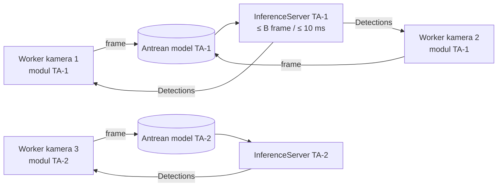

# FASE 9 — Optimasi Sumber Daya Multi-Kamera, Integrasi DVR & Packaging

> Sebelumnya: [FASE-08](FASE-08-profil-konfigurasi-preset.md) · Kembali ke [Roadmap](00-ROADMAP.md) · Berikutnya: [FASE-10 Pengujian & Evaluasi](FASE-10-pengujian-evaluasi.md)
> Referensi Proposal: **§3** (analitik real-time di PC/edge berbiaya wajar), **§10** (skalabilitas kamera per node)
> Estimasi: **4 minggu** · Milestone: **M5** (bagian 1) · Menjawab: **RM-3** (utama) dan **RM-2** (DVR)
> *Revisi 2026-11-09: dahulu FASE-08. Kini menjadi **kontribusi inti**. Metrik utamanya diubah dari "FPS 1 kamera" menjadi **kapasitas kamera per PC**, dan ditambah integrasi DVR/NVR multi-channel.*

---

## 1. Tujuan

1. Mendefinisikan dan **mengukur kapasitas** `N_max`, yaitu jumlah kamera maksimum yang dapat dilayani satu PC edge dengan kualitas layanan terjaga.
2. Menerapkan teknik optimasi secara **bertahap dan terukur** (ablation), sehingga kontribusi setiap teknik terhadap `N_max` dan pemakaian sumber daya terlihat.
3. **Inferensi terpusat + batching** lintas kamera untuk model YOLO11 milik modul.
4. Integrasi **DVR/NVR**: banyak channel dari satu perangkat, sub-stream, dan batas koneksi.
5. **Packaging** installer Windows & Linux, termasuk cara mendistribusikan modul tim.
6. Kesiapan operasional: watchdog, logging, *soak test*.

## 2. Definisi Kapasitas (kriteria QoS)

Sebuah konfigurasi **N kamera** dinyatakan *terlayani* bila selama 10 menit pengukuran, **setiap** kamera memenuhi:

| Kriteria | Ambang awal (disepakati dengan TA-1/TA-2) | Alasan |
|---|---|---|
| FPS analitik efektif | ≥ `F_min` = 8 FPS | Tracker MOT (terutama Re-ID) butuh laju minimum; nilainya diambil dari `manifest.params.min_fps` atau kesepakatan |
| Latensi frame→hasil p95 | ≤ 500 ms | Overlay & alert terasa real-time |
| Frame di-*drop* oleh antrean inferensi | ≤ 5% dari frame yang dijadwalkan | Bukan drop karena stride yang disengaja |
| Pemakaian sumber daya | CPU < 90%, VRAM < 90%, RAM stabil | Sisakan ruang untuk GUI & OS |

`N_max` = N terbesar yang lolos semua kriteria. Hasilnya dilaporkan **per perangkat × per modul** (baseline, TA-1, TA-2), karena biaya modul berbeda-beda.

## 3. Instrumentasi & Alat Ukur

### 3.1 Waktu per tahap

`StageTimes` (Fase 6) diperluas:

| Tahap | Diukur di |
|---|---|
| `decode_ms` | `RTSPSource` (PyAV/OpenCV) |
| `queue_ms` | Menunggu giliran di `InferenceServer` |
| `detect_ms` | Inferensi YOLO11 (dibagi rata per frame dalam batch) |
| `module_ms` | `module.process()` (tracker + analitik rekan) |
| `render_ms` | Annotate + konversi `QImage` (hanya tile yang terlihat) |
| `latency_ms` | `time.monotonic()` saat hasil siap − `Frame.ts` |

Nilai rata-rata per menit masuk `camera_health` (Fase 7). Pemakaian CPU/RAM (`psutil`) dan GPU/VRAM (`pynvml`) masuk `system_minute`.

### 3.2 Simulasi N kamera — `scripts/sim_cameras.sh`

MediaMTX (sudah ada di repo) + ffmpeg mem-*publish* N stream dari file secara berulang. Ini sama persis dengan pola beban kamera nyata, tetapi bisa diulang:

```bash
#!/usr/bin/env bash
# Pemakaian: scripts/sim_cameras.sh <video> <N> [fps] [lebar]
VIDEO=$1; N=$2; FPS=${3:-15}; W=${4:-1280}
for i in $(seq 1 "$N"); do
  ffmpeg -nostdin -loglevel error -re -stream_loop -1 -i "$VIDEO" \
    -vf "fps=$FPS,scale=$W:-2" -c:v libx264 -preset veryfast -tune zerolatency -g "$FPS" \
    -f rtsp "rtsp://127.0.0.1:8554/cam$i" &
done
wait
```

> Encoding N stream juga memakan CPU di PC yang sama. Untuk angka final, jalankan simulator di **PC kedua** dalam LAN, atau pre-encode file lalu gunakan `-c copy`.

### 3.3 Benchmark kapasitas — `scripts/benchmark_capacity.py`

Menjalankan aplikasi *headless* (tanpa GUI, atau dengan `QT_QPA_PLATFORM=offscreen`) dengan N = 1, 2, 4, 6, 8, …, hingga kriteria §2 gagal. Untuk setiap N, warm-up 60 s lalu ukur 10 menit. Keluarannya CSV per N (FPS min/median per kamera, latensi p50/p95, drop%, CPU%, GPU%, RAM, VRAM) dan nilai `N_max`.

```
python scripts/benchmark_capacity.py --module modules/ta1-perilaku-konsumen \
    --rtsp "rtsp://127.0.0.1:8554/cam{i}" --cams 1,2,4,6,8,12,16 --config cfg/opt_full.yaml
```

`scripts/compare_models.py` dan `compare_trackers.py` lama (membandingkan akurasi) dipensiunkan atau dipindah ke `scripts/legacy/`, karena perbandingan akurasi adalah ranah TA-1.

## 4. Baseline (kondisi sebelum optimasi)

Dari audit kode 2026-11-09, aplikasi saat ini:

| Kondisi | Dampak ke kapasitas |
|---|---|
| `PipelineWorker` membuat `Pipeline` sendiri → **satu salinan model per kamera** | VRAM/RAM naik linear dengan N, GPU berganti konteks terus |
| Inferensi batch = 1 per kamera | GPU kurang termanfaatkan |
| Model PyTorch FP32 | Lebih lambat dari TensorRT FP16 / OpenVINO |
| Default main-stream, decode resolusi penuh | CPU decode H.264/H.265 besar, resize mahal |
| Annotate + `QImage` untuk setiap kamera yang berjalan | CPU terbuang untuk tile yang tidak terlihat |
| Semua kamera = thread dalam **satu proses Python** | Kode modul berbasis Python bersaing di GIL |

Ukur `N_max` baseline **sebelum** mengubah apa pun. Angka ini menjadi pembanding semua hasil.

## 5. Teknik Optimasi

### 5.1 InferenceServer bersama + batching dinamis — `aio_cctv/inference/server.py`

Satu server **per bobot model**. Semua kamera yang memakai modul yang sama berbagi satu model.



```python
import queue
import threading
from concurrent.futures import Future


class InferenceServer(threading.Thread):
    """Satu model, banyak kamera. Tracker & modul tetap per kamera (state tidak boleh tercampur)."""

    def __init__(self, detector, max_batch: int = 8, max_wait_s: float = 0.01, max_queue: int = 64):
        super().__init__(name=f"inference-{detector.name}", daemon=True)
        self.detector, self.max_batch, self.max_wait_s = detector, max_batch, max_wait_s
        self.q: queue.Queue = queue.Queue(maxsize=max_queue)   # backpressure, lihat §5.7
        self._stop = threading.Event()

    def submit(self, frame) -> Future:
        fut: Future = Future()
        self.q.put_nowait((frame, fut))          # queue.Full -> worker men-drop frame ini
        return fut

    def run(self) -> None:
        while not self._stop.is_set():
            try:
                items = [self.q.get(timeout=0.1)]
            except queue.Empty:
                continue
            try:
                while len(items) < self.max_batch:
                    items.append(self.q.get(timeout=self.max_wait_s))
            except queue.Empty:
                pass
            try:
                results = self.detector.detect_batch([f for f, _ in items])
                for (_, fut), det in zip(items, results):
                    fut.set_result(det)
            except Exception as e:
                for _, fut in items:
                    fut.set_exception(e)

    def stop(self) -> None:
        self._stop.set()
```

`Detector.detect_batch(frames)` = `self.model(frames, ...)` → `[sv.Detections.from_ultralytics(r) ...]`. Server dibuat dan dibagikan oleh `CameraManager` (*reference counting*: dibuat saat kamera pertama yang memakai model itu mulai, dihentikan saat kamera terakhir berhenti).

**Variabel yang diukur:** `max_batch` ∈ {1, 2, 4, 8, 16}, `max_wait_s` ∈ {0, 5, 10, 20 ms}. Ini *trade-off* antara throughput dan latensi.

### 5.2 Backend inferensi (dari bobot YOLO11 rekan)

```python
from ultralytics import YOLO

m = YOLO("modules/ta1-perilaku-konsumen/weights/best.pt")
m.export(format="engine", imgsz=640, half=True, batch=8, dynamic=True)  # TensorRT FP16
m.export(format="onnx", imgsz=640, dynamic=True, simplify=True)        # ONNX Runtime
m.export(format="openvino", imgsz=640)                                 # CPU/iGPU Intel
```

- Ekspor dilakukan **host** saat modul pertama kali dipasang atau dijalankan (*first-run*). Hasilnya di-cache di `APP_DIR/cache/engines/<sha256 bobot>-<backend>-<imgsz>-b<batch>/`. File `.engine` terikat ke GPU & versi TensorRT, sehingga tidak dibawa di installer.
- **Auto-select:** TensorRT (NVIDIA + TRT) → ONNX CUDA → OpenVINO (CPU Intel) → ONNX CPU → PyTorch.
- Validasi wajib: output backend hasil ekspor vs `.pt` pada `samples/` modul (IoU rata-rata > 0.95, jumlah deteksi ±2%). Uji paritas Fase 6 diulang untuk setiap backend, dan selisih metrik modul dicatat. FP16 bisa sedikit mengubah hasil, sehingga perlu dilaporkan.

### 5.3 Decode & stream

| Teknik | Implementasi | Catatan |
|---|---|---|
| **Sub-stream untuk analitik** | `PerfSettings.stream = "sub"` (Fase 8); main-stream hanya saat tile diperbesar (*dual-stream*) | Template merek Fase 4 sudah punya URL `sub` |
| **HW decode** | PyAV: `codec_context` dengan `hwaccel` (NVDEC/VAAPI/QSV); OpenCV: `CAP_PROP_HW_ACCELERATION` (sudah ada flag `hw_accel` di `RTSPSource`) | Ukur CPU% H.264 vs H.265 |
| **Resize saat decode** | Skala ke ≤ imgsz × rasio sebelum masuk antrean | Mengurangi memcpy & preprocessing |
| **Thread decode** | `thread_type = "AUTO"` (sudah ada) vs `"SLICE"` | Ukur pada N besar: terlalu banyak thread → kontensi |

### 5.4 Frame stride & FPS adaptif

- Proses setiap *k* frame, atau tetapkan `target_fps` per kamera (Fase 8, default 10). Frame di luar jadwal dibuang **sebelum** decode penuh bila memungkinkan, atau minimal sebelum inferensi.
- `CameraContext.fps` diisi **FPS efektif**, supaya buffer lost-track pada tracker rekan tetap benar dalam satuan detik (kontrak Fase 6 §4.3).
- Dampaknya terhadap kualitas tracking (ID switch) **bukan diukur di TA ini**. Cukup sepakati `F_min` dengan rekan (§2), lalu jangan turun di bawahnya.

### 5.5 Render hemat

- Annotate + `QImage` **hanya untuk tile yang terlihat**. Kamera di halaman lain atau saat jendela diminimalkan tetap dianalisis tanpa render.
- `display_fps` (sudah ada, default 15) diturunkan ke 5–10 untuk grid besar (3×3, 4×4).
- Resize ke ukuran tile **sebelum** konversi `QImage`.

### 5.6 Proses vs thread (GIL)

Kode modul (tracker, Re-ID, analitik) sebagian besar Python/NumPy. Pada N besar, satu proses bisa mentok di GIL sementara GPU menganggur. Bandingkan tiga arsitektur:

| Arsitektur | Deskripsi | Kompleksitas |
|---|---|---|
| **A. Thread** (saat ini) | Semua worker + InferenceServer di satu proses | Rendah |
| **B. Proses per grup kamera** | `multiprocessing` (spawn): tiap proses menjalankan decode + modul untuk ≤ G kamera; inferensi tetap di proses utama; frame dikirim lewat `multiprocessing.shared_memory` (ring buffer), hasil kecil lewat `Queue` | Sedang |
| **C. Proses per grup + inferensi per proses** | Tiap proses punya InferenceServer sendiri | Rendah–sedang, tetapi model terduplikasi per proses |

Pilih berdasarkan pengukuran. Implementasikan B hanya bila A terbukti mentok di CPU (satu core 100%, GPU < 60%) sebelum memenuhi `N_max` yang diharapkan.

### 5.7 Penjadwalan, backpressure & degradasi bertahap

- Antrean inferensi berbatas (`max_queue`). Bila penuh, **frame terbaru menggantikan yang lama** per kamera (latest-frame), sehingga latensi tidak menumpuk.
- **Fairness:** server mengambil frame secara *round-robin* per kamera, supaya satu kamera berfps tinggi tidak memonopoli batch.
- **Degradasi bertahap** saat beban berlebih: turunkan `target_fps` semua kamera secara merata (tidak di bawah `F_min`). Bila masih berat, kamera berprioritas `low` dijeda dan alert `overload` (Fase 7) dikirim. Jangan biarkan semua kamera lambat bersamaan.
- **Auto-tune saat first-run:** jalankan benchmark singkat (30 s) untuk memilih backend, `max_batch`, dan rekomendasi jumlah kamera. Tampilkan "PC ini direkomendasikan untuk ±N kamera dengan modul X".

## 6. Integrasi DVR/NVR (RM-2)

Kondisi saat ini: `configs/camera_brands.json` menulis `channel=1` / `Channels/101` secara tetap. Akibatnya, hanya channel pertama DVR yang bisa dipakai.

| Pekerjaan | Rincian |
|---|---|
| Template URL berparameter channel | `{channel}` & `{stream}`, mis. Hikvision `/Streaming/Channels/{channel}0{stream}` (101, 102, 201…), Dahua `cam/realmonitor?channel={channel}&subtype={stream}` |
| Dialog **Tambah DVR/NVR** | IP + akun sekali → jumlah channel (ONVIF `GetProfiles`/`GetVideoSources` bila tersedia, atau input manual) → probe tiap channel paralel (`QThreadPool`) → pilih channel → membuat N kamera yang berbagi kredensial (keyring sekali) |
| Pengelompokan di GUI | Kamera dikelompokkan per perangkat DVR; status "DVR offline" vs "channel tanpa sinyal" dibedakan |
| Batas perangkat | DVR sering membatasi jumlah stream RTSP bersamaan dan total bandwidth keluaran. Catat batas tiap model yang diuji; default ke **sub-stream** untuk semua channel |
| Reconnect terkoordinasi | Bila semua channel satu DVR putus bersamaan, backoff dilakukan per perangkat (bukan N koneksi ulang serentak yang membanjiri DVR) |

Uji minimal: **1 DVR fisik (≥ 4 channel)** dengan merek yang tersedia (Hikvision/Dahua/XMEye), ditambah kamera IP dari Fase 4.

## 7. Matriks Eksperimen (Ablation)

Setiap baris **menambahkan** satu teknik ke baris sebelumnya. Ukur `N_max` dan sumber daya pada N tetap (mis. N = 8).

| # | Konfigurasi | `N_max` | FPS/kamera (N=8) | Latensi p95 | CPU % | GPU % | VRAM | RAM |
|---|---|---|---|---|---|---|---|---|
| 0 | Baseline (§4) | | | | | | | |
| 1 | + InferenceServer bersama (batch 1) | | | | | | | |
| 2 | + batching dinamis (B terbaik) | | | | | | | |
| 3 | + TensorRT FP16 / OpenVINO | | | | | | | |
| 4 | + sub-stream | | | | | | | |
| 5 | + HW decode | | | | | | | |
| 6 | + FPS adaptif (target 10) | | | | | | | |
| 7 | + render hemat | | | | | | | |
| 8 | + multi-proses (bila dipakai) | | | | | | | |

Dijalankan pada **≥ 2 kelas perangkat**:

| Perangkat | Spesifikasi | Backend utama |
|---|---|---|
| PC GPU (lab) | Ryzen 5 5600 + RTX 5060 (logbook Fase 0) | TensorRT FP16 |
| PC/laptop tanpa GPU diskrit | mis. Intel Core i5 + iGPU | OpenVINO |
| *(opsional)* Mini PC / Jetson | — | TensorRT |

…dan untuk **setiap modul** (baseline, TA-1, TA-2), karena `module_ms` (mis. Re-ID TA-2) bisa menjadi hambatan utama. Laporkan juga **kamera per watt** bila alat ukur daya tersedia.

## 8. Packaging

### 8.1 Varian distribusi

| Varian | Isi | Perkiraan ukuran | Target |
|---|---|---|---|
| **Lite** | PyQt6 + OpenCV/PyAV + onnxruntime/OpenVINO | ± 300–500 MB | PC tanpa GPU NVIDIA |
| **GPU** | + PyTorch CUDA / TensorRT | ± 2–3 GB | PC dengan GPU NVIDIA |

Modul yang memerlukan PyTorch saat runtime (mis. Re-ID TA-2 via boxmot) **tidak bisa** berjalan di varian Lite, kecuali rekan mengekspor Re-ID ke ONNX. Bahas ini dengan TA-2 dan dokumentasikan sebagai batasan.

### 8.2 Modul dalam distribusi

- Modul **tidak dibundel** ke executable. Modul dipasang sebagai folder/ZIP di `APP_DIR/modules/` (menu Modul, Fase 6), sehingga pembaruan modul tidak memerlukan installer baru.
- `requirements` setiap modul yang disepakati (Fase 6 §7) sudah termasuk di build. Modul yang meminta paket di luar daftar ditandai tidak valid.

### 8.3 Build

PyInstaller mode **one-folder** (atau Nuitka `--standalone --enable-plugin=pyqt6`). Resource dibaca melalui `BASE = Path(getattr(sys, "_MEIPASS", ...))`. Installer: Inno Setup (Windows) dan AppImage (Linux), dan diuji di mesin/VM bersih tanpa Python.

### 8.4 Kesiapan operasional

| Aspek | Implementasi |
|---|---|
| Logging | `RotatingFileHandler` 5 × 5 MB; password di URL dimask |
| Crash handler | `sys.excepthook` → simpan traceback + dialog |
| Watchdog | Worker tanpa frame > 30 s → restart worker; InferenceServer mati → restart + alert |
| Tray & auto-start | Analitik tetap berjalan saat jendela ditutup ke tray |
| Versi | `aio_cctv.__version__`, `CHANGELOG.md`, menu Tentang (beserta daftar modul & versinya) |

### 8.5 Soak test

Build rilis berjalan **24–72 jam** dengan N = `N_max` − 1 kamera (campuran kamera nyata, channel DVR, dan simulasi). Catat RSS, VRAM, CPU/GPU, FPS, dan reconnect per menit (`camera_health`, `system_minute`). Targetnya: memori tidak naik monoton, tidak ada crash, dan kriteria §2 tetap terpenuhi.

## 9. Keluaran (Deliverables)

| Keluaran | Lokasi |
|---|---|
| `InferenceServer`, ekspor & auto-select backend, cache engine | `aio_cctv/inference/` |
| Dukungan DVR multi-channel + dialog Tambah DVR | `aio_cctv/sources/`, `configs/camera_brands.json`, `aio_cctv/gui/dialogs/` |
| `sim_cameras.sh`, `benchmark_capacity.py` | `scripts/` |
| Tabel ablation + grafik `N_max` per perangkat × modul | `docs/logbook/` (bahan Bab IV, RM-3) |
| Installer Windows & AppImage Linux | rilis GitHub |
| Grafik soak test | `docs/logbook/` |

## 10. Definition of Done

- [ ] `N_max` baseline dan sesudah optimasi terukur pada ≥ 2 perangkat × ≥ 2 modul.
- [ ] Peningkatan `N_max` dari setiap teknik terdokumentasi (tabel §7 lengkap).
- [ ] Satu model per bobot walau N kamera (VRAM tidak naik linear terhadap N).
- [ ] DVR fisik ≥ 4 channel berjalan bersamaan.
- [ ] Build Lite berjalan di PC tanpa Python & tanpa GPU (dengan modul baseline/ONNX).
- [ ] Soak test 24 jam lulus.
- [ ] Tag `v1.0.0-rc1`.

## 11. Risiko & Mitigasi

| Risiko | Mitigasi |
|---|---|
| Hambatan utama ada di modul rekan (`module_ms`), bukan di host | Laporkan terpisah; kapasitas baseline menunjukkan batas host; beri umpan balik ke rekan (mis. Re-ID hanya untuk track baru/ambigu) |
| Batching menaikkan latensi | `max_wait_s` kecil + ukur p95; batch dinamis |
| Ekspor TensorRT gagal di PC pengguna | Auto-select jatuh ke ONNX CUDA; pesan jelas |
| Hasil FP16 berbeda dari FP32 | Uji paritas per backend; opsi paksa FP32 |
| DVR menolak banyak koneksi bersamaan | Sub-stream default; batas koneksi per perangkat dapat diatur; relay via MediaMTX |
| Simulator memakan CPU PC uji | Simulator di PC kedua, atau `-c copy` dari file pre-encoded |
| Antivirus menandai executable | Nuitka / tanda tangan kode; laporkan false positive |
