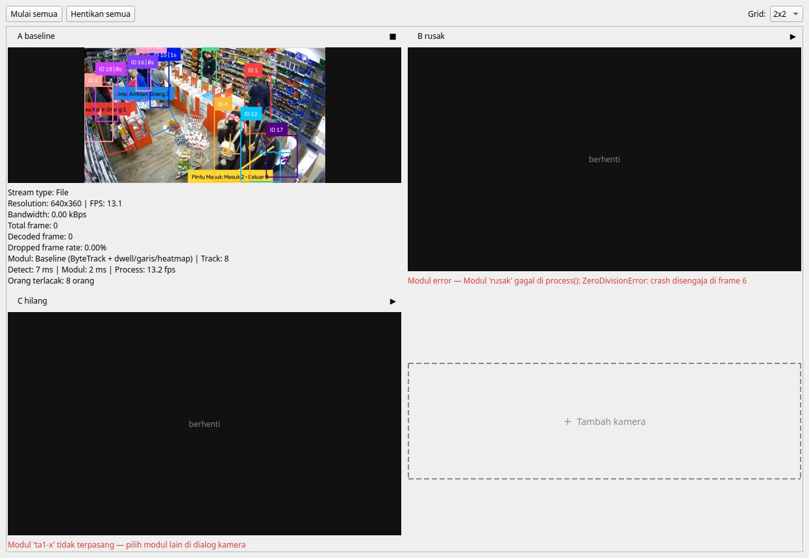
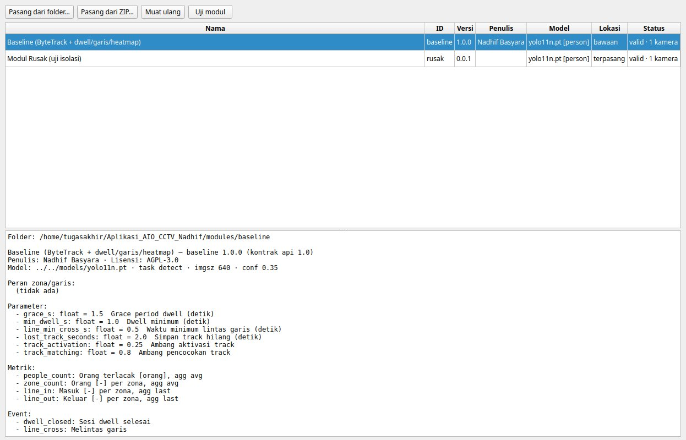
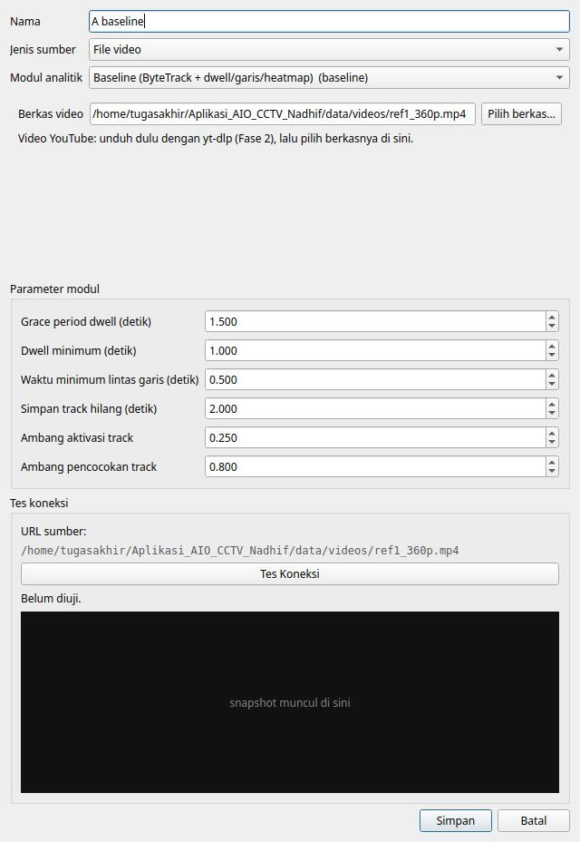
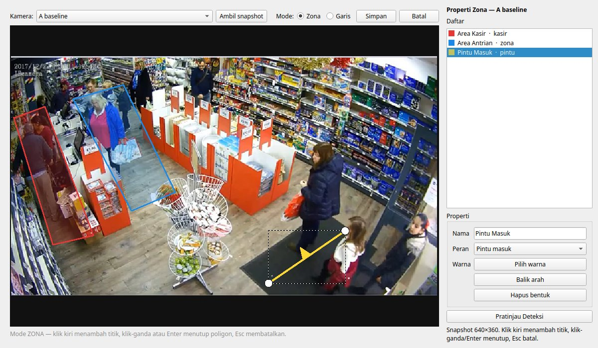

# Logbook — 9 November 2026 (Fase 6)

> **Fase:** 6 — Integrasi Model & Modul Analitik Tim ([FASE-06](../fase/FASE-06-integrasi-model-modul-tim.md))
> **Latar belakang:** revisi ruang lingkup pasca sidang pra-progres ([Roadmap §0](../fase/00-ROADMAP.md#0-catatan-revisi-2026-11-09)). Aplikasi menjadi *host*; model YOLO11, tracker, dan analitik berasal dari TA-1 & TA-2.
> **Logbook sebelumnya:** [2026-09-20 — Fase 5](2026-09-20-fase-05.md)
> **Status fase:** ⚠️ **SELESAI DI SISI HOST.** Kontrak, loader, modul baseline, alat uji, dan GUI selesai dan terverifikasi. **Belum ada modul dari TA-1/TA-2**, dan kontrak v1 belum disepakati bersama. Tag `v0.6-module-host` **ditunda** sampai minimal satu modul rekan lulus `check_module`.

---

## 1. Ringkasan Kegiatan

1. Kontrak host–modul v1:
   - `aio_cctv/modules/api.py`: `Region`, `CameraContext` (+ `zones()`, `lines()`, `to_pixels()`), `Metric`, `Event`, `ModuleResult`, `AnalyticsModule`.
   - `aio_cctv/modules/manifest.py`: skema `module.yaml` (Pydantic), validasi versi mayor API, file, requirements, dan key duplikat; `resolve_params()` dengan konversi tipe & batas min/max.
   - `docs/kontrak-modul.md`: panduan untuk TA-1/TA-2.
2. `aio_cctv/modules/registry.py`: menemukan modul di `modules/` (repo) dan `APP_DIR/modules/` (pengguna), memasang dari folder/ZIP (menolak *zip slip*), dan memuat folder modul sebagai paket unik `aio_mod_<id>` (mendukung import relatif, tanpa bentrok nama file antarmodul).
3. `aio_cctv/modules/host.py`: `ModuleRunner` mengukur `module_ms`, membuat frame *read-only*, membungkus exception menjadi `ModuleError`, serta `validate_result()` dan `result_to_record()` (format JSONL paritas).
4. `Detector` membaca kelas dari `model.names` bobot (tabel `COCO_NAME_TO_ID` dihapus) dan menambah `from_manifest()` serta `detect_batch()`.
5. `Pipeline` baru: Detector (host) → ModuleRunner. Annotator generik (`aio_cctv/annotate.py`) menggambar label/satuan metrik per zona dari manifest.
6. **Modul baseline** (`modules/baseline/`): kode Fase 3 dipindah dengan `git mv` (riwayat terjaga) lalu dibungkus `BaselineModule`. `aio_cctv/analytics/` dan `aio_cctv/tracking/` dihapus dari host.
7. Skrip: `check_module.py` (baru), `run_module.py` (pengganti `run_analytics.py`), `run_live.py` diperbarui, `compare_models.py`/`compare_trackers.py` dipindah ke `scripts/legacy/` (ranah TA-1).
8. GUI:
   - halaman **Modul** (daftar, rincian, pasang folder/ZIP dengan SHA-256 & peringatan kepercayaan, uji modul);
   - pilihan modul dan formulir parameter otomatis di dialog kamera;
   - kolom Modul di tabel kamera;
   - kombo **Peran** menggantikan Tipe di editor zona;
   - statistik tile generik;
   - Pengaturan: pilihan model/confidence/grace dihapus.

## 2. Lingkungan Uji

| Komponen | Nilai |
|---|---|
| Perangkat | Ryzen 5 5600 + RTX 5060 (lihat [logbook Fase 0](2026-09-19.md)) |
| Python / Ultralytics / Supervision | 3.11.15 / 8.4.155 / 0.30.4 |
| Video uji | `data/videos/ref1_360p.mp4` (640×360, 13,09 fps, 1452 frame) |
| Profil uji | `configs/profiles/demo_ref1.json` (2 zona, 1 garis) |
| Modul | `baseline` 1.0.0 (yolo11n, kelas `person`) |
| GUI | `QT_QPA_PLATFORM=offscreen`, `XDG_DATA_HOME`/`XDG_CONFIG_HOME` sementara (data pengguna asli tidak tersentuh) |

## 3. Uji Paritas Refaktor (bukti RM-1)

Pipeline **lama** (sebelum Fase 6) dijalankan dua kali pada video uji. Hasilnya identik byte-per-byte, jadi pipeline-nya deterministik dan bisa dijadikan acuan. Pipeline **baru** (modul baseline lewat kontrak, mode `strict`) kemudian dibandingkan per frame:

| Aspek | Frame berbeda (dari 1452) |
|---|---|
| Track (ID + kotak, 2 desimal) | 0 |
| Jumlah orang per zona | 0 |
| Total masuk/keluar garis | 0 |
| Sesi dwell selesai (zona, track, mulai, selesai) | 0 |
| Crossing (garis, track, arah, waktu) | 0 |
| Label durasi per track | 0 |
| Sesi yang ditutup saat berhenti (`flush`/`close`) | identik |

Total: 38 sesi dwell dan 9 crossing, sama di kedua pipeline. **Kesimpulan:** pemindahan analitik ke balik kontrak modul tidak mengubah hasil sama sekali.

## 4. Uji Kepatuhan (`check_module.py`)

```
$ python scripts/check_module.py modules/baseline --video data/videos/ref1_360p.mp4 \
      --profile configs/profiles/demo_ref1.json --frames 0 --expected <acuan>.jsonl
[OK] manifest valid (baseline 1.0.0, api 1.0)
[OK] file lengkap
[OK] requirements terpenuhi
[OK] bobot dimuat: kelas = {0: 'person'}, imgsz 640
[OK] entrypoint analyzer:BaselineModule dapat diinstansiasi
[OK] 1452 frame ref1_360p.mp4: tidak ada exception
[OK] semua Metric.key, Event.type & Event.data sesuai kontrak
[INFO] detect_ms p50 6.3 / p95 6.8 · module_ms p50 1.3 / p95 1.5
[OK] paritas vs baseline_ref.jsonl: identik
[INFO] event per tipe (hasil, acuan): {'dwell_closed': (38, 38), 'line_cross': (9, 9)}
```

Mode cepat tanpa video (dipakai tombol "Uji modul"): 5 frame hitam, semua butir OK.

Catatan awal untuk Fase 9: pada baseline, `detect_ms` (6,3 ms) ≈ 5× `module_ms` (1,3 ms) per frame di RTX 5060. Angka ini menjadi titik awal pengukuran kapasitas.

## 5. Uji GUI Headless

| Skenario | Hasil |
|---|---|
| Kamera A = baseline, B = modul uji yang crash di frame 6, C = modul tidak terpasang; ketiganya dijalankan bersamaan | A tetap berjalan **13,1 fps** (= fps video), 99 frame tampil dalam 9 s. B berhenti dengan "Modul error — Modul 'rusak' gagal di process(): ZeroDivisionError…". C ditolak **sebelum** membuka sumber: "Modul 'ta1-x' tidak terpasang" |
| Statistik tile A | `module`, `tracks` 8, `detect_ms` 6,8, `module_ms` 1,5, metrik "Orang terlacak: 8 orang" (label & satuan dari manifest) |
| Dialog kamera | Kombo modul + 6 parameter baseline terbangkit dari manifest. Mengubah `grace_s` → `module_params = {'grace_s': 3.0}` (hanya nilai yang berbeda dari default) |
| Editor zona dengan modul berperan (`kasir` zona, `pintu` garis) | Opsi peran sesuai jenis bentuk; tersimpan `Zone.role='kasir'`, `Line.role='pintu'` |
| Hentikan semua | Semua worker berhenti, `close()` modul terpanggil |






## 6. Unit Test

`pytest`: **21 lulus**. Rinciannya: 6 tes baseline (dipindah ke `tests/baseline/`, impor dari paket `aio_mod_baseline`), 4 tes model zona, dan 11 tes baru di `tests/test_modules.py`:
- validasi manifest (versi API, bobot hilang, konversi & batas params);
- dua modul dengan `analyzer.py`/`helper.py` bernama sama tidak bentrok;
- pemasangan dari ZIP berfolder induk, penolakan duplikat & *replace*, penolakan *zip slip*;
- konteks membawa peran & params;
- frame read-only;
- exception modul dibungkus `ModuleError` beserta id modul;
- `validate_result` menangkap metrik/event tak terdaftar dan `Event.data` berisi ndarray.

## 7. Keputusan & Alasan

| Keputusan | Alasan |
|---|---|
| Modul dimuat sebagai paket `aio_mod_<id>`, bukan `spec_from_file_location` per file (rancangan awal §5.2) | Rancangan awal tidak mendukung import relatif. Padahal modul nyata terdiri dari banyak file (baseline sendiri: 6 file). Nama paket unik juga mencegah bentrok `analyzer.py` antarmodul |
| `ModuleResult.heat` = grid akumulasi ≥ 0, host yang menormalisasi (rancangan awal: 0..1) | Menormalisasi tiap frame membebani modul. Host hanya perlu menormalisasi saat benar-benar menggambar heatmap |
| Pilihan modul disimpan di `CameraConfig.module_id/module_params`, belum di profil | Skema profil v2 adalah pekerjaan Fase 8; kamera lama otomatis memakai `baseline` |
| Kombo "Tipe" zona diganti "Peran"; field `Zone.type` tetap ada | Tipe dwell/occupancy/presence adalah semantik baseline. Field lama dipertahankan agar profil lama tetap valid |
| `module_params` hanya menyimpan nilai yang berbeda dari default | Bila rekan mengubah default di versi modul baru, kamera yang tidak diatur khusus ikut memakai default baru |
| Bobot baseline dirujuk `../../models/yolo11n.pt` | `models/` tidak ikut git (lisensi & ukuran). Akibatnya baseline hanya berjalan dari repo, bukan bila disalin ke `APP_DIR/modules` (dicatat sebagai batasan) |

## 8. Belum Selesai / Tindak Lanjut

- [ ] Bagikan `aio_cctv/modules/api.py` + `docs/kontrak-modul.md` + `modules/baseline/` ke TA-1 & TA-2; sepakati butir §7 dokumen fase.
- [ ] Terima modul v0 TA-1 & TA-2 → `check_module.py` → uji paritas dengan `expected.jsonl` mereka → tag `v0.6-module-host`.
- [ ] Uji GUI interaktif manual (pasang ZIP lewat dialog berkas, editor zona dengan mouse) di desktop asli; uji di atas berjalan headless.
- [ ] Tile sumber file menampilkan `Total frame: 0`/`Decoded frame: 0` karena `FileSource` tidak punya `stats` (bawaan Fase 5, tidak berubah di sini).
- [ ] Folder `ta2-produktivitas/` di root repo (salinan contoh manifest, tidak dibuat di sesi ini) tidak dipindai registry dan sebaiknya dihapus.
