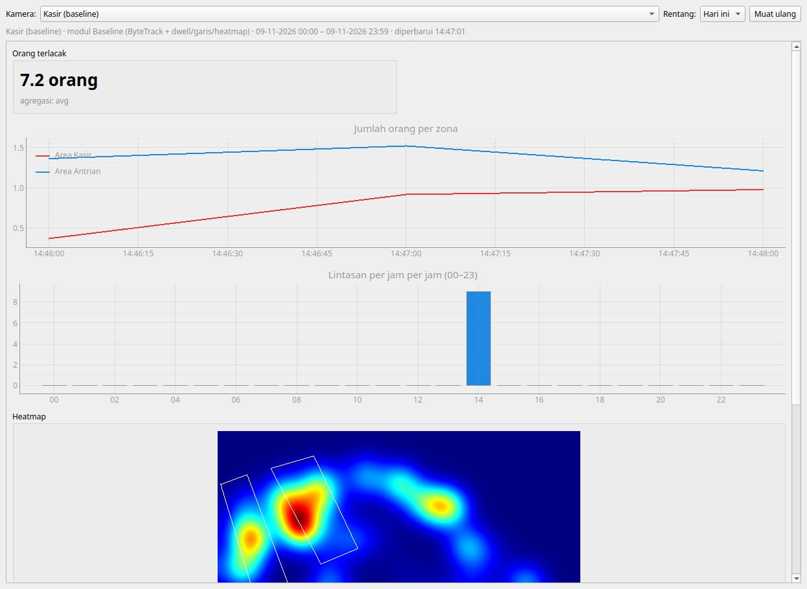
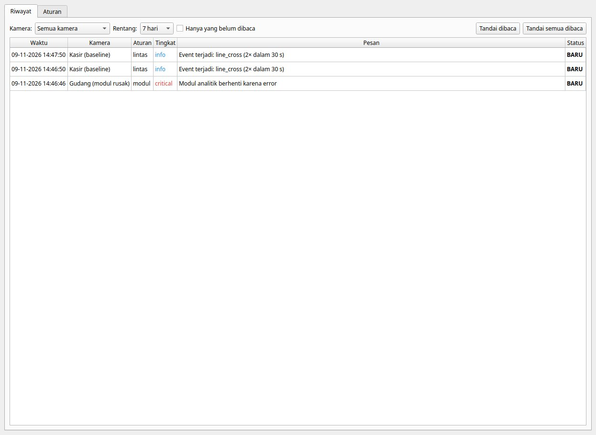
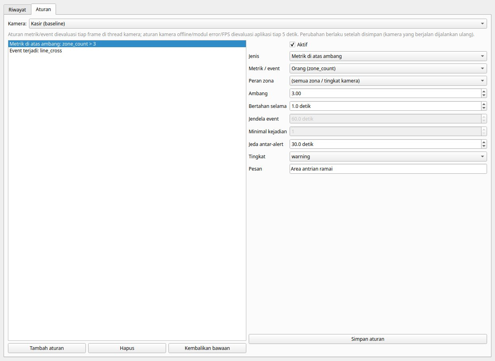
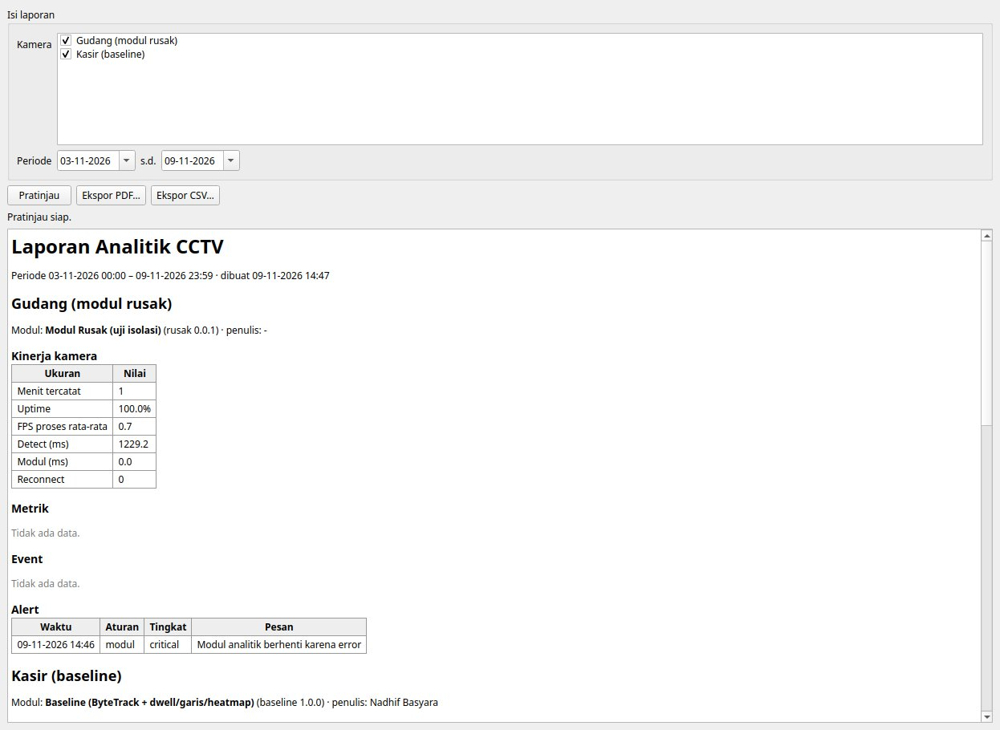
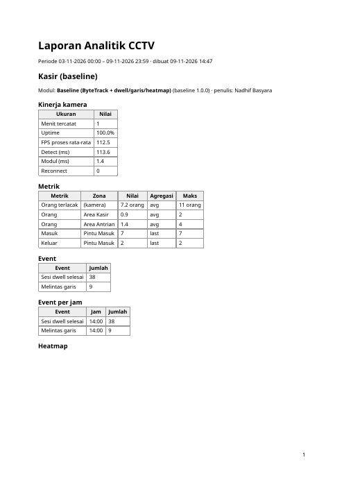
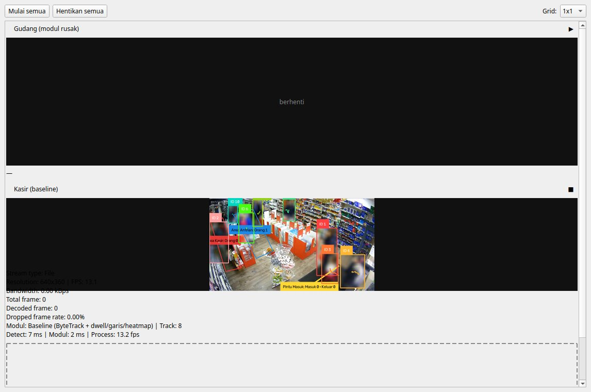

# Logbook — 9 November 2026 (Fase 7)

> **Fase:** 7 — Penyimpanan Data, Dashboard, Alert & Laporan (Generik) ([FASE-07](../fase/FASE-07-penyimpanan-dashboard-alert-laporan.md))
> **Logbook sebelumnya:** [2026-11-09 — Fase 6](2026-11-09-fase-06.md)
> **Status fase:** ⚠️ **SELESAI SEBAGIAN.** Semua komponen selesai dan terverifikasi dengan modul baseline + modul uji pada sumber file video. Belum diuji: beban 8 kamera × 8 jam (menunggu simulasi N kamera Fase 9), *crash-safety* (matikan paksa), `camera_offline` pada kamera fisik, dan modul TA-1/TA-2. Tag `v0.7-data-dashboard` ditunda.

---

## 1. Ringkasan Kegiatan

1. **Penyimpanan generik** (`aio_cctv/storage/`):
   - skema SQLite (`metric_minute`, `events`, `heat_hour`, `alerts`, `camera_health`, `system_minute`), WAL;
   - `StorageWriter`: satu thread, batch per detik, antrean berbatas (baris dibuang & dihitung bila penuh, worker tidak pernah menunggu disk);
   - `Aggregator`: `ModuleResult` menjadi agregat per menit (avg/min/max/last/n), event (waktu sumber dikonversi ke epoch), dan heatmap per jam (disimpan sebagai **selisih** grid kumulatif);
   - `HealthRecorder`: rata-rata statistik worker per menit;
   - `queries.py`: koneksi read-only, agregasi mengikuti `agg` manifest;
   - `purge()`: retensi N hari.
2. **Alert** (`aio_cctv/alerts/rules.py`): model `Rule` (Pydantic) dan `RuleEngine`.
   - Aturan data (`metric_gt/lt`, `event`) dievaluasi di thread worker setiap frame.
   - Aturan host (`camera_offline`, `module_error`, `overload`) dievaluasi `CameraManager` tiap 5 s.
   - Alert ditulis ke DB, lalu dikirim ke GUI (status bar, tray, hitungan "Alert (n)").
3. **Pemakaian sumber daya** (`aio_cctv/core/sysmon.py`): CPU sistem, RAM proses, utilisasi GPU, dan VRAM proses (pynvml), dirata-rata per menit ke `system_minute`. Ini bahan langsung untuk Fase 9.
4. **GUI**:
   - **Analitik**: widget KPI/grafik waktu/jam sibuk/tabel event/heatmap dari `manifest.dashboard`, ditambah widget kesehatan kamera bawaan host, dengan auto-refresh 30 s;
   - **Alert**: tab Riwayat (filter, tandai dibaca) dan tab Aturan (pilihan metrik/event/peran dari manifest);
   - **Laporan**: pratinjau, PDF, CSV;
   - **Pengaturan**: grup "Data & privasi" (blur, retensi, notifikasi tray).
5. **Laporan** (`aio_cctv/reports/`):
   - HTML laporan dibangun tanpa Qt (bisa dites), lalu PDF dibuat lewat `QTextDocument` + `QPdfWriter`;
   - CSV per tabel, dengan kolom waktu lokal.

## 2. Hasil Uji End-to-End (headless, data terisolasi)

Skenario:
- **Kamera A** memakai baseline dan memutar seluruh `ref1_360p.mp4` (1452 frame, tanpa pemutaran real-time), dengan dua aturan:
  - `zone_count > 3` selama 1 s;
  - `line_cross` ≥ 2× dalam 30 s.
- **Kamera B** memakai modul uji yang crash di frame ke-6.

| Pemeriksaan | Hasil |
|---|---|
| Event di DB vs keluaran `run_module.py` (Fase 6) | **identik**: 38 `dwell_closed`, 9 `line_cross` |
| Metrik per menit | 15 baris, 4 metrik (`people_count`, `zone_count`, `line_in`, `line_out`) |
| Heatmap / kesehatan kamera / sumber daya | 1 / 2 / 1 baris (CPU 12,4 %, RAM 1828 MB, GPU 30 %, VRAM 354 MB) |
| Alert | `module_error` kamera B (critical); `line_cross` ×2 kamera A (info, jeda 60 s dipatuhi). `zone_count > 3` tidak terpicu karena maks. 4 orang tidak bertahan ≥ 1 s |
| GUI | Tombol navigasi "Alert (3)"; status bar menampilkan alert |
| Writer | 70 baris tertulis, 0 dibuang |
| Laporan | PDF 2 halaman (~53 KB) dan 4 file CSV |
| Mode blur | Orang diburamkan di live view; kotak, ID, dan analitik tetap |

## 3. Unit Test

`pytest`: **39 lulus**, terdiri dari 21 tes lama + 18 tes baru:

`tests/test_storage.py` (10 tes):
- agregasi per menit dan flush saat berhenti;
- konversi waktu event dari domain sumber ke epoch;
- `Event.data` berisi ndarray atau berukuran > 2 KB ditolak;
- heatmap per jam tidak terhitung dobel di batas jam;
- `HealthRecorder` dan perhitungan uptime;
- antrean penuh membuang baris, bukan memblokir;
- keempat jenis `agg` serta pengelompokan per jam;
- alert dan *acknowledge*;
- retensi;
- laporan HTML dan CSV memakai label manifest.

`tests/test_rules.py` (8 tes):
- `for_s` dan cooldown;
- kondisi yang terputus mereset durasi;
- filter peran zona, termasuk peran yang tidak dikenal;
- jendela event;
- aturan host;
- aturan nonaktif dan aturan bawaan;
- validasi aturan.

## 4. Masalah yang Ditemukan & Diperbaiki

| # | Masalah | Perbaikan |
|---|---|---|
| 1 | Contoh kode dokumen (Fase 7 & 9) memakai `self._stop = threading.Event()` di subkelas `Thread`. Atribut itu menimpa metode internal `Thread._stop()`, sehingga `join()` bisa gagal | Diganti `_stop_event`, di kode maupun di dokumen |
| 2 | `purge()` saat DB belum ada membuat file kosong lalu gagal "no such table" | Writer (yang membuat skema) dibuat lebih dulu; `purge()` melewati DB yang belum ada |
| 3 | Dashboard menampilkan kamera yang salah bila pilihan diganti saat data masih dimuat | Permintaan saat memuat ditandai *pending*, lalu dimuat ulang setelah selesai |
| 4 | Sampel CPU pertama 0 % (`psutil` butuh panggilan awal) | `SystemSampler` dibuat saat `CameraManager` mulai |
| 5 | `AlertHistory.refresh` membaca widget Qt dari thread pool | Nilai filter dibaca di thread GUI sebelum dikirim |
| 6 | Judul grup Pengaturan "Sumber & tampilan" tampil "Sumber _tampilan" (bawaan Fase 5): `&` = shortcut Qt | Ditulis `&&` |
| 7 | Heatmap di PDF menempel ke judul | `` dibungkus `
` |
| 8 | Rentang "Hari ini" berakhir di "sekarang", sehingga event file video yang diputar lebih cepat dari waktu nyata terpotong | Rentang berakhir di akhir hari |

## 5. Keputusan & Alasan

| Keputusan | Alasan |
|---|---|
| Agregasi & evaluasi aturan data di **thread worker**, bukan di GUI | Sinyal per frame × N kamera ke thread GUI akan membebani UI; worker hanya menitipkan baris ke antrean |
| Aturan host di `CameraManager` | Saat kamera putus atau modul crash, worker tidak menghasilkan frame, sehingga tidak bisa mengevaluasi dirinya sendiri |
| Aturan disimpan di `CameraConfig.rules` | `ProfileV2` baru dibuat di Fase 8 |
| Heatmap disimpan sebagai selisih per jam | Kontrak `ModuleResult.heat` = akumulasi sejak modul mulai; menyimpan nilai kumulatif akan terhitung dobel saat dijumlah |
| VRAM diukur per proses (fallback: total GPU) | Fase 9 butuh pemakaian aplikasi sendiri, bukan seluruh GPU |
| Waktu lokal di dashboard & laporan (tanpa zona waktu eksplisit) | Aplikasi edge satu lokasi; epoch tetap disimpan di DB dan CSV |

## 6. Batasan & Tindak Lanjut

- [ ] Uji beban 8 kamera × 8 jam dan ukuran DB (setelah `sim_cameras.sh` Fase 9).
- [ ] Uji crash-safety: matikan paksa aplikasi saat menulis, lalu cek integritas DB.
- [ ] `camera_offline` dengan kamera fisik/MediaMTX yang dimatikan.
- [ ] Jika kamera dijalankan ulang di jam yang sama, baris `heat_hour` jam itu tertimpa oleh sesi baru (bukan dijumlah).
- [ ] Metrik kumulatif modul (mis. `line_in` dengan `agg: last`) mulai dari 0 lagi saat kamera dijalankan ulang. Untuk hitungan per jam, gunakan widget berbasis event (seperti `line_cross` di baseline). Ini perlu disampaikan ke TA-1/TA-2.
- [ ] Rangkuman `metric_minute` ke per jam setelah 30 hari (rancangan §3.7) belum dibuat; retensi saat ini menghapus.
- [ ] Telegram dan klip bukti alert (opsional) tidak dikerjakan.
