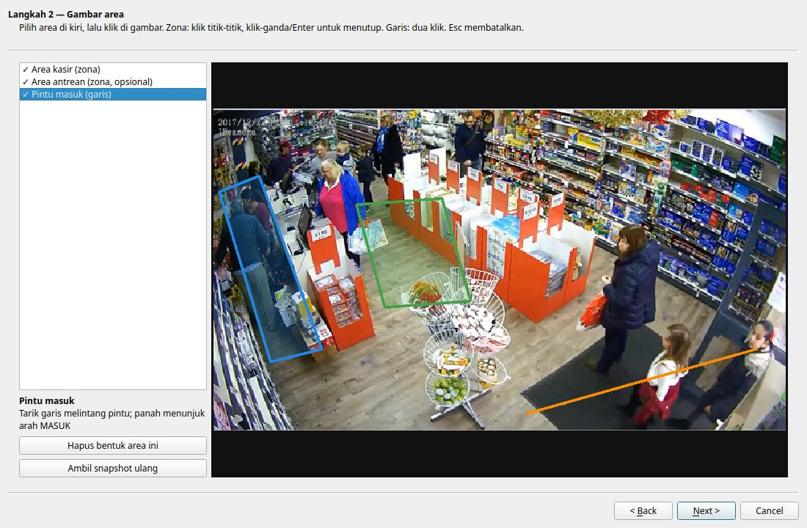
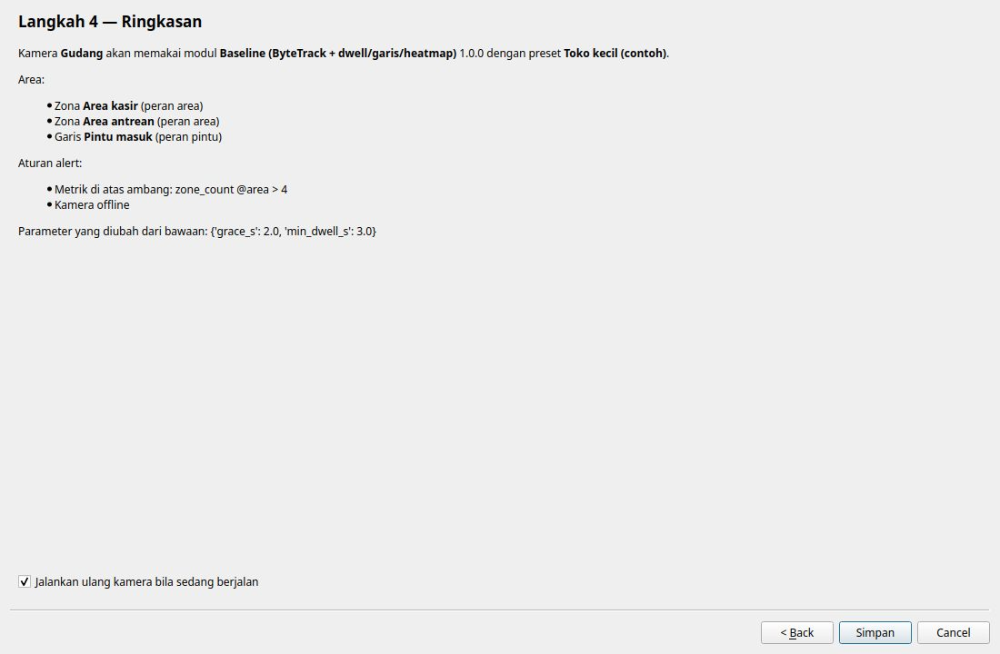
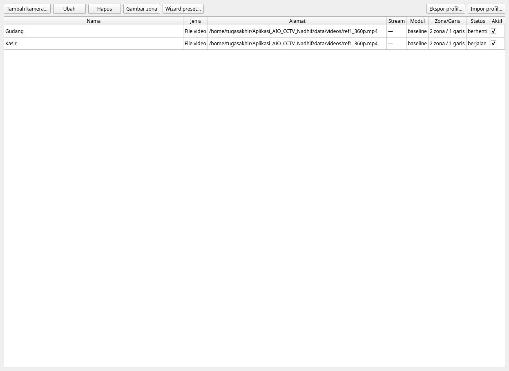
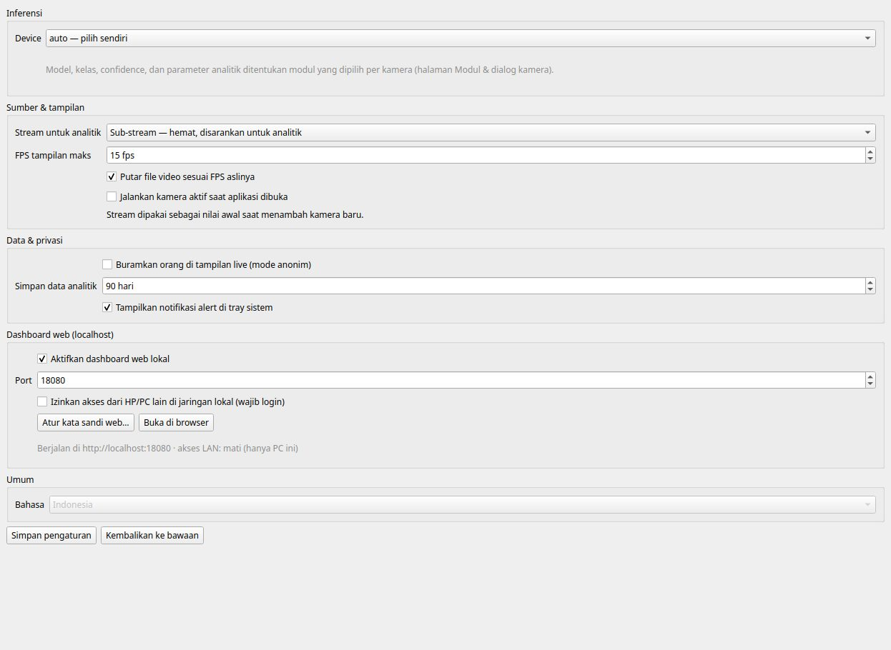
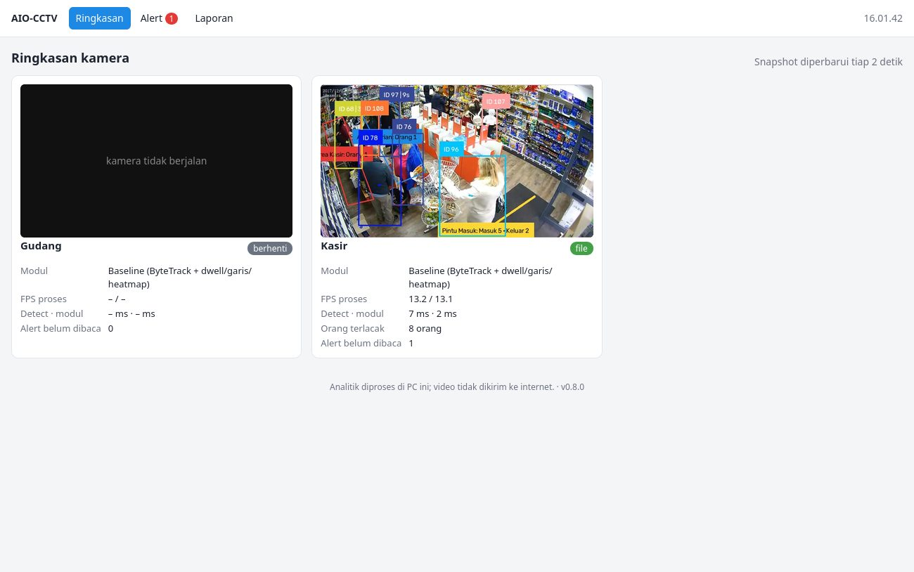
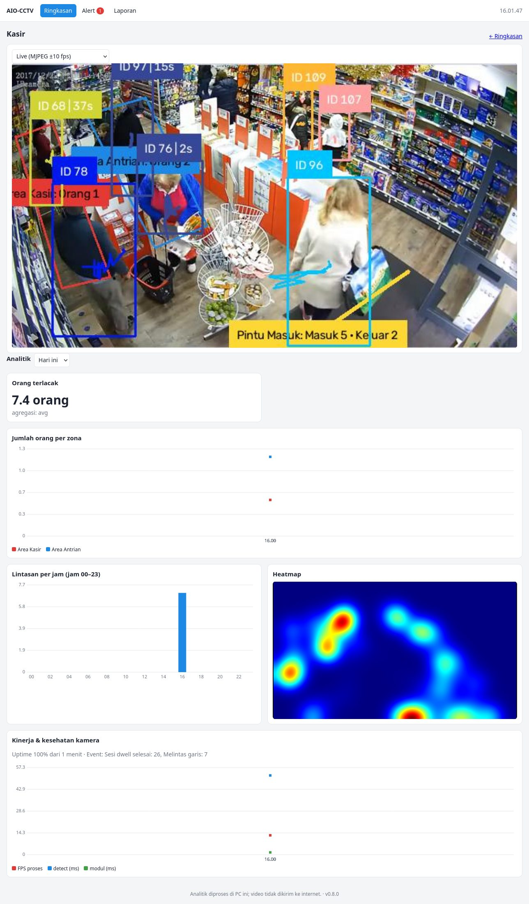
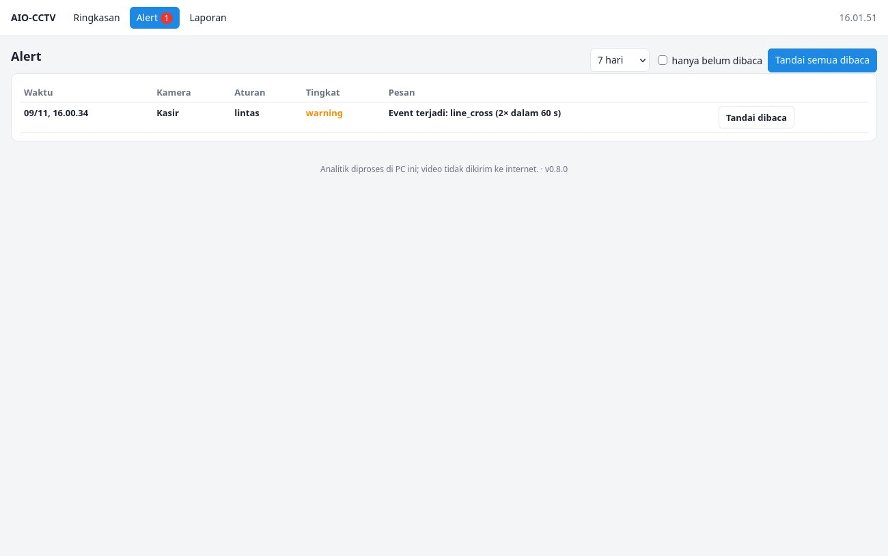
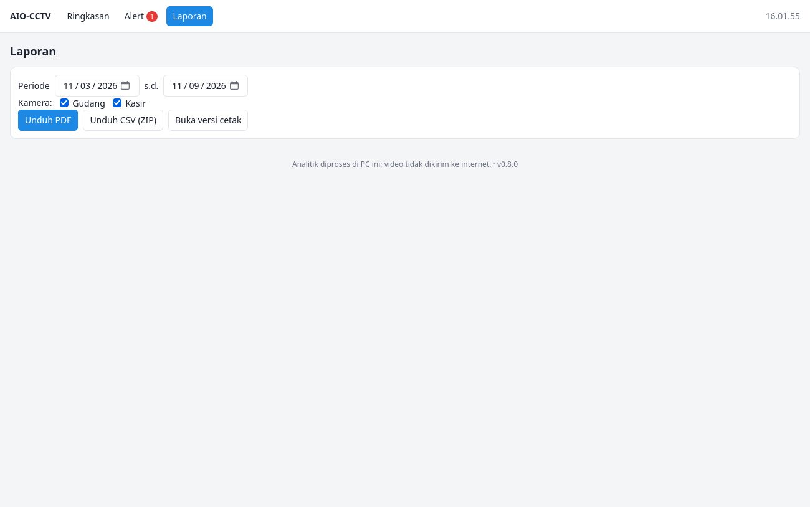

# Logbook — 9 November 2026 (Fase 8)

> **Fase:** 8 — Profil Kamera, Preset Modul, Import/Export & Dashboard Web Lokal ([FASE-08](../fase/FASE-08-profil-konfigurasi-preset.md))
> **Logbook sebelumnya:** [2026-11-09 — Fase 7](2026-11-09-fase-07.md)
> **Status fase:** ⚠️ **SELESAI SEBAGIAN.** Semua fitur selesai dan teruji dengan modul baseline. Yang belum: uji "0 baris kode" dengan modul TA-1/TA-2, wizard dengan preset dari ≥ 2 modul, dan akses LAN dari HP sungguhan. Tag `v0.8-profiles` ditunda.

---

## 1. Ringkasan Kegiatan

1. **Profil v2.** Modul, parameter modul, aturan alert, dan dashboard kini disimpan di **profil kamera**, bukan di `cameras.json`.
   - Profil v1 dimigrasi otomatis saat dibaca.
   - `cameras.json` format Fase 6–7 dimigrasi sekali saat aplikasi dibuka: kunci lama dipindah ke profil lalu dihapus.
   - `CameraManager` mendapat API `profile()`, `save_profile()`, dan `module_id()`; semua halaman memakainya.
2. **Preset modul.**
   - Skema `Preset`/`PresetSlot`; validasi peran, parameter, aturan, dan widget terhadap manifest. Preset rusak hanya menjadi *peringatan*.
   - Baseline mendapat peran label (`area`, `pintu`) dan preset contoh "Toko kecil".
3. **Wizard 4 langkah** (`preset_wizard.py`): modul & preset → gambar tiap slot di snapshot kamera → parameter & aturan (bisa dinonaktifkan) → ringkasan & simpan, lalu kamera dijalankan ulang. Logikanya (`apply_preset`) murni Python dan dites tanpa Qt.
4. **Ekspor/impor `.aioprofile`.**
   - Isinya ZIP: `profile.json` tanpa sumber/URL/kredensial, `meta.json`, dan snapshot opsional.
   - Saat impor, id, nama, dan sumber kamera tujuan dipertahankan, dan pengguna diperingatkan bila modulnya belum terpasang atau versinya berbeda.
5. **Dashboard web lokal** (`aio_cctv/web/`):
   - FastAPI + uvicorn sebagai thread latar di dalam aplikasi desktop, dengan default `127.0.0.1:8080`.
   - Halaman: Ringkasan (snapshot tiap 2 s), Kamera (MJPEG ±10 fps + widget analitik), Alert (tandai dibaca), Laporan (PDF/CSV/versi cetak).
   - Akses LAN harus diaktifkan eksplisit dan wajib login. Hash PBKDF2 kata sandi disimpan di OS keyring; sesi memakai cookie `HttpOnly`/`SameSite=Strict`.
   - Frontend HTML/JS tanpa CDN (grafik digambar sendiri di canvas), sehingga jalan tanpa internet.
   - `FrameHub` menampung frame terakhir per kamera dari worker, tanpa anotasi tambahan.
6. Pemuat data dashboard dipindah ke `storage/dashboard_data.py` dan dipakai bersama desktop & web, sehingga angkanya dijamin sama.
7. Versi aplikasi `aio_cctv.__version__ = "0.8.0"` (dicatat di `.aioprofile` dan footer web).

## 2. Hasil Uji End-to-End (headless, data terisolasi)

| Pemeriksaan | Hasil |
|---|---|
| Migrasi `cameras.json` format Fase 7 | Kunci `module_id`/`module_params`/`rules` hilang dari `cameras.json`; profil `camA` menjadi v2 dengan `grace_s: 2.5` dan aturan `lintas` |
| Server web | Berjalan di `http://localhost:18080`; status tampil di status bar & Pengaturan |
| `/api/cameras` | Status, FPS proses 13,2, detect/modul ms, metrik, alert belum dibaca |
| Snapshot | JPEG ±77 KB |
| MJPEG | **31 frame dalam 3 s (≈ 10,3 fps)**, sesuai batas 10 fps |
| Dashboard web | KPI, grafik per zona, jam sibuk, heatmap (tampil saat kamera masih berjalan), kesehatan kamera |
| Akses lewat IP LAN saat izin LAN mati | **Ditolak** (koneksi tidak diterima; server hanya di 127.0.0.1) |
| Wizard preset "Toko kecil" pada kamera B | 2 zona (`area`), 1 garis (`pintu`), aturan `ramai` + `offline`, 5 widget, `preset_id` tercatat |
| Preset baru "Kafe" (hanya file JSON, **tanpa perubahan kode**) | Langsung muncul di wizard |
| Ekspor kamera A → impor ke kamera B | `.aioprofile` ±80 KB berisi snapshot; zona & aturan A terpasang di B; sumber video B tetap |
| Menutup aplikasi | Server web ikut berhenti |

Screenshot web diambil dengan Firefox headless lewat geckodriver (WebDriver), supaya JavaScript sempat memuat data sebelum dipotret.

## 3. Unit Test

`pytest`: **57 lulus**, terdiri dari 40 tes lama + 17 tes baru:

`tests/test_profiles.py` (8 tes):
- migrasi v1 → v2;
- preset baseline valid;
- `apply_preset` (zona/garis/peran/aturan/dashboard, slot wajib, bentuk ganda bernomor);
- preset "Kosong" mempertahankan zona & membuang aturan modul lama;
- preset rusak menjadi peringatan;
- `.aioprofile` tanpa URL dan roundtrip;
- ZIP non-profil ditolak.

`tests/test_web.py` (9 tes):
- halaman & health;
- daftar kamera;
- snapshot & 404;
- MJPEG;
- **angka dashboard web = loader desktop**;
- alert & ack;
- CSV ZIP & laporan HTML;
- login wajib saat LAN aktif (salah/benar/logout);
- hash kata sandi & masa berlaku sesi.

`tests/test_storage.py` (+1 tes): heatmap jam berjalan terlihat sebelum jam berakhir, ditulis dengan REPLACE tanpa dobel.

## 4. Masalah yang Ditemukan & Diperbaiki

| # | Masalah | Perbaikan |
|---|---|---|
| 1 | Wizard: `ModulePage` memanggil `wiz.preset` saat dibuat, sebelum `page_module` terpasang (`AttributeError`) | Properti aman bila halaman belum ada; deskripsi diulang setelah wizard lengkap |
| 2 | Web: kotak login & frame kosong tetap tampil walau ber-`hidden` (CSS `display` mengalahkan atribut) | `[hidden] { display: none !important; }` |
| 3 | Web: tabel alert menampilkan `[object HTMLTableRowElement]` (`replaceChildren` tidak meratakan array) | Baris di-spread |
| 4 | Heatmap tidak tampil selama kamera berjalan (desktop & web) karena baru ditulis saat jam berganti/kamera berhenti | Jam berjalan ikut ditulis tiap pergantian menit (`INSERT OR REPLACE`) |
| 5 | Pengaturan menampilkan "Tidak berjalan" padahal server aktif | Status diperbarui setelah server dijalankan |
| 6 | Deskripsi aturan host berakhiran titik dua ("Kamera offline:") | Titik dua hanya bila ada detail |
| 7 | `firefox --screenshot` menggantung bila Firefox lain berjalan, dan memotret sebelum JS memuat data | Screenshot lewat geckodriver dengan jeda |

## 5. Keputusan & Alasan

| Keputusan | Alasan |
|---|---|
| Model `Profile` diperluas ke v2, bukan kelas `ProfileV2` baru | `Profile` dipakai di ±10 tempat (editor zona, pipeline, host, annotator); migrasi lewat `model_validator` tanpa mengganti pemakai |
| Modul & aturan pindah dari `cameras.json` ke profil | Profil menjadi satu paket konfigurasi kamera yang bisa diekspor/diimpor utuh |
| Web read-only (kecuali tandai dibaca) | Konfigurasi (kamera, zona, modul) memerlukan snapshot & interaksi kaya yang sudah ada di desktop; permukaan serangan web lebih kecil |
| Grid = snapshot, detail = MJPEG, WebRTC tidak dibuat | Beban encode hanya untuk kamera yang ditonton; WebRTC (video mulus tanpa overlay) dicatat sebagai pengembangan lanjut |
| Server web di dalam proses aplikasi (thread) | Pengguna tidak perlu menjalankan program kedua; berbagi DB, FrameHub, dan status kamera tanpa IPC |
| Login hanya saat LAN aktif | Di `127.0.0.1` hanya pengguna PC itu yang bisa mengakses; login wajib begitu dibuka ke jaringan |

## 6. Batasan & Tindak Lanjut

- [ ] Wizard & uji "0 baris kode" dengan modul + preset TA-1/TA-2.
- [ ] Uji akses dari HP di LAN (izin LAN aktif + login) di jaringan sungguhan. Saat ini login diuji unit; mengubah kata sandi menulis ke keyring pengguna sehingga tidak diuji otomatis.
- [ ] Ukur beban MJPEG per penonton (CPU encode JPEG) di Fase 9.
- [ ] Wizard belum menampilkan panah arah pada garis; arah dapat dicek/dibalik di editor zona.
- [ ] Endpoint PDF web memakai Qt di thread server. Berjalan di aplikasi desktop, tetapi bila gagal tersedia versi cetak HTML.
- [ ] Sinkronisasi cloud (opsional) tidak dikerjakan.

## 7. Tambahan: perbaikan cara baca dashboard (masukan uji dengan kamera kelas A234)

Saat dicoba pada kamera sungguhan, KPI "Orang terlacak" menampilkan **0,1 orang** padahal ada 1 orang di ruangan. Angka itu benar (rata-rata seluruh menit hari ini: ruang kosong 14:50–15:32, lalu ±1 orang sejak 16:04), tetapi menyesatkan. Grafik juga menarik garis lurus melintasi celah 31 menit tanpa data, seolah jumlah orang naik perlahan.

| Perubahan | Rincian |
|---|---|
| KPI menampilkan keadaan **sekarang** | Angka besar = nilai live dari worker (`live_metrics` di statistik) bila kamera berjalan, atau nilai **terakhir** tersimpan beserta jamnya. Di bawahnya: rata-rata/agregat rentang + maksimum. Berlaku di desktop & web |
| Grafik garis **terputus** di celah data | Jarak antar-titik > 2 bucket (2 menit untuk "Hari ini") = garis diputus (`with_gaps` + `connect="finite"` di pyqtgraph; logika setara di canvas web). Titik tunggal digambar sebagai kotak kecil |
| Kueri baru | `queries.metric_latest()` |
| Tes | +2: `with_gaps` hanya memutus di celah; KPI berisi now/latest/avg/max. Tes web memeriksa KPI "sekarang" dari statistik live. Total **59 lulus** |

## 8. Tambahan: KPI "sekarang" tidak bergerak tanpa memuat ulang halaman

Laporan pengguna: jumlah orang di halaman kamera baru berubah setelah halaman di-refresh. Hasil pengecekan pada aplikasi yang berjalan: data di server **berubah tiap detik** (4 → 5 orang dalam 6 detik), tetapi halaman detail kamera (web) dan halaman Analitik (desktop) hanya memuat ulang widget tiap 30 detik.

| Perubahan | Rincian |
|---|---|
| Web | Endpoint ringan `GET /api/cameras/{id}/live` (nilai metrik terakhir worker). Halaman kamera memanggilnya tiap **2 detik** dan hanya mengganti angka KPI; grafik tetap dimuat ulang tiap 30 detik |
| Desktop | Sinyal baru `CameraManager.stats_updated`; halaman Analitik mengganti angka KPI setiap kali statistik worker datang (tiap detik) |
| Bukti | Firefox headless membuka halaman kamera sekali tanpa refresh; KPI terbaca 9 → 7 → 8 → 6 orang dalam 16 detik. +1 unit test endpoint `/live` (total **60 lulus**) |

## 9. Tambahan: grafik ikut bergerak otomatis

Permintaan pengguna: grafik juga diperbarui otomatis, seperti KPI. Kendala: grafik menampilkan **rata-rata per menit** dari database, dan satu menit baru tersimpan setelah menit itu selesai, sehingga ujung grafik tertinggal hingga ±1,5 menit.

| Perubahan | Rincian |
|---|---|
| Ujung grafik live (menit berjalan) | `LiveTail` (Python) & padanannya di JS mengumpulkan nilai live per menit dan meringkasnya dengan `agg` manifest yang sama seperti Aggregator. Titik menit berjalan bergerak tiap detik (desktop) / 2 detik (web), dan setelah menit selesai nilainya sama dengan yang tersimpan |
| Muat ulang penuh lebih sering | 30 s → **15 s** (heatmap, jam sibuk, tabel event, kesehatan) di desktop & web |
| Jam server | `/api/cameras/{id}/live` mengirim `ts` server, supaya menit berjalan di HP dengan jam berbeda tetap benar |
| Label sumbu waktu | Label paling kiri/kanan tidak lagi terpotong di tepi canvas |
| Bukti | Desktop: ujung kurva zona berubah 1,0 → 0,75 / 1,0 → 1,25 dalam 6 detik. Web (Firefox headless, tanpa refresh): isi canvas grafik berubah 5 dari 6 kali dalam 15 detik. +1 unit test `LiveTail`. Total **61 lulus** |
